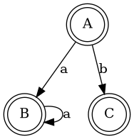
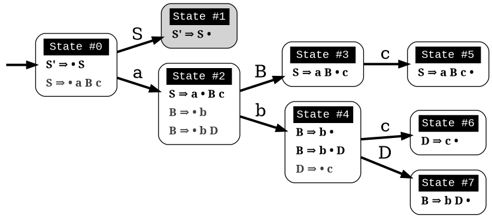
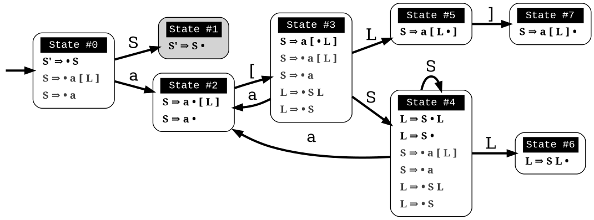
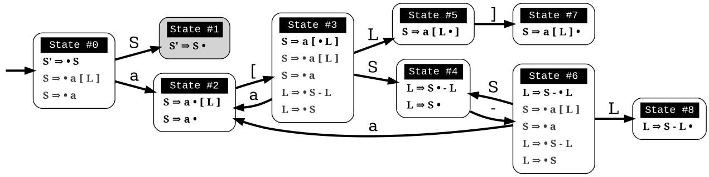
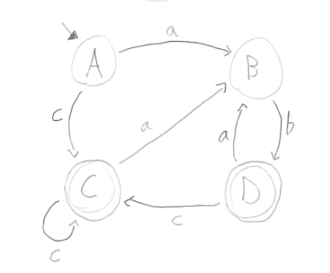
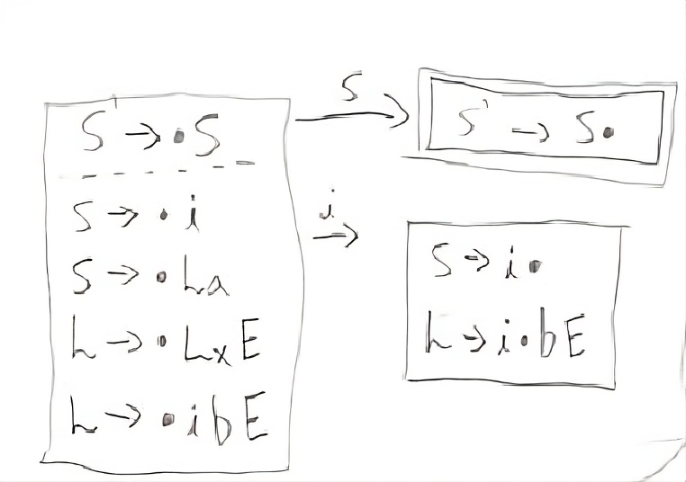
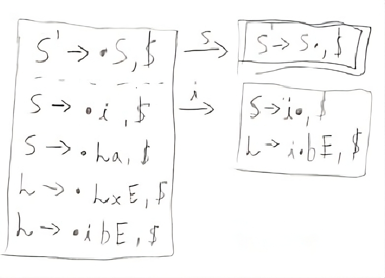

#+STARTUP: overview
#+STARTUP: indent

Em ordem cronológica reversa.

PR são bem-vindos para popular esta página.

* P1
** 2025/2
*** E1
1. Os passos
   1. Fech-\epsilon(0) = {0, 1, 2, 3, 5, 6, 7, 8} = A;
   2. Fech-\epsilon(Mov(A, a)) = {4, 5, 6, 7, 1, 2, 3} = B;
   3. Fech-\epsilon(Mov(A, b)) = {9, 7} = C;
   4. Fech-\epsilon(Mov(B, a)) = {4, 5, 6, 7, 1, 2, 3} = B;
   5. Fech-\epsilon(Mov(B, b)) = {}
   6. Fech-\epsilon(Mov(C, a)) = {}
   7. Fech-\epsilon(Mov(C, b)) = {}
2. O autômato
   #+begin_src txt :tangle img/2025-2-E1.dot
   digraph {
      A [shape=doublecircle];
      B [shape=doublecircle];
      C [shape=doublecircle];
      A -> B [ label = "a" ];
      A -> C [ label = "b" ];
      B -> B [ label = "a" ];      
   }
   #+end_src
   #+begin_src shell :results output :exports both
   dot -Tpng img/2025-2-E1.dot -o img/2025-2-E1.png
   #+end_src

   #+RESULTS:

   
*** E2
1. Não é, por causa do conflito reduz-reduz do estado #3.
2. É, pois Seq(A) não tem intersecção com o Seq(B).
   #+begin_src shell :results output :exports both
   echo 'S => A c | B d ;
A => z ;
B => z ;' > gramatica.ee
   ./firstfollow < gramatica.ee | grep -A10 'Follow sets'
   #+end_src

   #+RESULTS:
   : Follow sets:
   : S -- $ 
   : A -- c 
   : B -- d 
   
3. Tabela SLR(1)

   |   | c        | d        | z | $         | S | A | B |
   |---+----------+----------+---+-----------+---+---+---|
   | 0 |          |          | 3 |           | 1 | 2 | 4 |
   | 1 |          |          |   | Ac        |   |   |   |
   | 2 | 5        |          |   |           |   |   |   |
   | 3 | R (A->z) | R (B->z) |   |           |   |   |   |
   | 4 |          | 6        |   |           |   |   |   |
   | 5 |          |          |   | R (S->Ac) |   |   |   |
   | 6 |          |          |   | R (S->Bd) |   |   |   |

4. Análise

   | Pilha   | Entrada | Ação  |
   |---------+---------+-------|
   | % 0     | zc %    | e3    |
   | % 0 3   | c %     | R, e2 |
   | % 0 2   | c %     | e5    |
   | % 0 2 5 | %       | R, e1 |
   | % 0 1   | %       | Ac    |

*** E3
1. Conjuntos PRI e SEQ
   #+begin_src shell :results output :exports both
   echo 'F => n = A - e | n e ;
A => - a | ;' > gramatica.ee
   ./firstfollow < gramatica.ee | grep -A10 'First sets'
   #+end_src

   #+RESULTS:
   : First sets:
   : F -- n 
   : A -- ε - 
   : 
   : Follow sets:
   : F -- $ 
   : A -- -

2. Não é, pois
   1. Pri(n=A-e) intersecciona com Pri(ne)
   2. Seq(A) contém Pri(-a)
3. Reescrevendo
   1. Fatorar as regras de F
      #+begin_src text
      F -> n Y
      Y -> = A - e | e
      #+end_src
   2. Resolver a questão do A
      #+begin_src text
      F -> n Y
      Y -> = - a - e
      Y -> = - e
      Y -> e
      #+end_src
   3. Fatorar Y
      #+begin_src text
      F -> n Y
      Y -> e
      Y -> = - Z
      Z -> a - e
      Z -> e
      #+end_src
   Agora fazendo a tabela LL(1). Consideramos a gramática reescrita.

   |   | a     | e | =     | - | n   | $ |
   |---+-------+---+-------+---+-----+---|
   | F |       |   |       |   | n Y |   |
   | Y |       | e | = - Z |   |     |   |
   | Z | a - e | e |       |   |     |   |

*** E4
- Semelhança: todos usam o mesmo algoritmo de análise
- Diferença: a forma como a redução é identificada
*** E5
1. Incorreto. O Estado #4 não tem o item LR(1): =A->d.,a=
2. Tabela LR(1) apenas dos estados pares

   |   | a | b | d | $ | S | A |
   |---+---+---+---+---+---+---|
   | 0 |   | 2 |   |   | 1 |   |
   | 2 |   |   | 4 |   |   | 3 |
   | 4 | 6 |   |   |   |   |   |
   | 6 |   |   |   | R |   |   |

** 2025/1
*** E1

1. A ER reconhecida é esta =((ab)+|b*)b=
2. Foi construído pois todos os elementos básicos, ou seja, os
   reconhecedores dos símbolos =a= e =b= (nos diferentes locais) estão bem
   isolados e organizados por intermédio de produções vazias. A
   implementação das duas repetições também faz uso de novos estados
   de início e fim.
3. Fech-\epsilon(0) = {0, 1, 2, 3, 8, 9, 10, 12, 13, 14, 15};
4. Fech-\epsilon(Mov(A, b)) = {11, 16, 12, 13, 14, 15, 8, 9, 10, 17};
 
*** E2

1. A resposta

   |   | Pri   | Seq   |
   |---+-------+-------|
   | S | a b c | $     |
   | A | a \epsilon   | a b c |
   | B | a b \epsilon | a c   |
   | C | a c   | $     |

   Podemos empregar [[https://github.com/schnorr/ellerre][ellerre]] para verificar a resposta.
   #+begin_src shell :results output :exports both
   echo 'S => A B C ;
A => a | ;
B => a | b | ;
C => a | c ;' > gramatica.ee
   ./firstfollow < gramatica.ee | grep -A10 'First sets'
   #+end_src

   #+RESULTS:
   #+begin_example
   First sets:
   S -- a b c 
   A -- ε a 
   C -- a c 
   B -- ε a b 

   Follow sets:
   S -- $ 
   A -- a b c 
   C -- $ 
   B -- a c 
   #+end_example

2. Segue a tabela LL(1).
   |---+-----+-----+-----+---|
   |   | a   | b   | c   | $ |
   |---+-----+-----+-----+---|
   | S | ABC | ABC | ABC |   |
   |---+-----+-----+-----+---|
   | A | a   |     |     |   |
   |   | \epsilon   | \epsilon   | \epsilon   |   |
   |---+-----+-----+-----+---|
   | B | a   | b   |     |   |
   |   | \epsilon   |     | \epsilon   |   |
   |---+-----+-----+-----+---|
   | C | a   |     | c   |   |
   |---+-----+-----+-----+---|

3. A gramática não é LL(1) pois:
   - Nas regras A->a|\epsilon, o conjunto Pri(a) intersecta com Seq(A).
   - Nas regras B->b|\epsilon, o conjunto Pri(a) intersecta com Seq(B).

*** E3

1. Vamos empregar [[https://github.com/schnorr/ellerre][ellerre]] para obter a resposta.
   #+begin_src shell :results output :exports both
   echo 'S => a B c ;
B => b | b D ;
D => c ;' > gramatica.ee
   ./lr0 < gramatica.ee > /dev/null
   ./firstfollow < gramatica.ee
   dot -Tpng LR0.dot -o resp_2025_1-E3-LR0.png
   #+end_src

   #+RESULTS:

   

2. A gramática não é LR(0) pois no estado 4 temos um item completo
   juntamente com empilhamentos (conflito empilha-reduz).

3. A gramática não é SLR(1) pois no estado 4 temos um item completo
   que indica redução com o token =c= (que faz parte do conjunto
   sequência do não-terminal =B=) ao mesmo tempo que temos empilhamentos
   com este mesmo token. O conflito empilha-reduz se mantém.
   #+begin_src shell :results output :exports both
   ./firstfollow < gramatica.ee | grep -A10 'Follow sets'
   #+end_src

   #+RESULTS:
   : Follow sets:
   : S -- $ 
   : B -- c 
   : D -- c 

*** E4

1. Não é uma gramática LR(0) pois no estado 3 temos um item completo
   indicando que trata-se de um estado de redução, ao mesmo tempo que
   temos uma transição que indica empilhamento. Trata-se portanto do
   conflito empilha-reduz no estado 3.
2. Calculando o conjunto sequência dos não-terminais com [[https://github.com/schnorr/ellerre][ellerre]] para
   nos auxiliar na resposta. A redução no estado 3 apenas ocorrerá
   quando o token na entrada for algum do conjunto sequência de E
   (não-terminal na cabeça da regra do item completo neste estado),
   que neste caso é o $. Como a transição a partir de 3 é com o token
   +, não temos mais conflito empilha-reduz, sendo assim a gramática é
   SLR(1).
   #+begin_src shell :results output :exports both
   echo 'S => E ;
E => T | T + E ;
T => id ;' > gramatica.ee
   ./firstfollow < gramatica.ee | grep -A10 'Follow sets'
   #+end_src

   #+RESULTS:
   : Follow sets:
   : S -- $ 
   : E -- $ 
   : T -- $ +
   
3. A gramática é LR(1) pois se ela é SLR(1) ela será
   LR(1). Detalhamento sobre o autômato LR(1), observamos que não
   existem itens completos onde o lookahead (após a vírgula) é igual
   ao símbolo empregado na transição a partir do estado do item.

4. Segue a tabela SLR(1).

   | / |   |  < | > |        |   |   |   |
   |   |   | id | + | $      | S | E | T |
   |---+---+----+---+--------+---+---+---|
   |   | 0 |  4 |   |        | 1 | 2 | 3 |
   |   | 1 |    |   | aceita |   |   |   |
   |   | 2 |    |   | R      |   |   |   |
   |   | 3 |    | 5 | R      |   |   |   |
   |   | 4 |    | R | R      |   |   |   |
   |   | 5 |  4 |   |        |   | 6 | 3 |
   |   | 6 |    |   | R      |   |   |   |

5. A análise LR usando a tabela SLR(1) acima. Novamente o =%= marca o
   final da pilha e da entrada.

   | / | <l>       |       <r> |              |
   |   | Pilha     |   Entrada | Ação         |
   |---+-----------+-----------+--------------|
   |   | % 0       | id + id % | 4            |
   |   | % 0 4     |    + id % | R (T -> id)  |
   |   | % 0 3     |    + id % | 5            |
   |   | % 0 3 5   |      id % | 4            |
   |   | % 0 3 5 4 |         % | R (T -> id)  |
   |   | % 0 3 5 3 |         % | R (E -> T)   |
   |   | % 0 3 5 6 |         % | R (E -> T+E) |
   |   | % 0 2     |         % | R (S -> E)   |
   |   | % 0 1     |         % | aceita       |

** 2024/2
*** E1

1. Sim, esta =(a*|(bc)*)=.
2. Não, pois se fosse construído utilizando os "blocos de construção
   de thompson" poderíamos observar transições vazias entre tais
   blocos. Por exemplo, para uma concatenação como =ab=, teríamos um
   estado vazio ligando o estado que reconhece =a= e o que reconhece =b=,
   o que não ocorre entre os estados 4 e 5 neste autômato.
3. Fech-\epsilon(0) = {0, 1, 2, 3, 6, 7, 14, 8, 9, 10, 12, 13} = A;
4. Mov(A, a) = {11}, mas habitualmente calcula-se o Fech-\epsilon do
   movimento (pois após a transição do símbolo ainda pode-se navegar
   com pelas produções vazias), portanto a resposta completa é
   Fech-\epsilon(Mov(A, a)) = {11, 12, 13, 14, 8, 9, 10};

*** E2

1. Os conjuntos primeiro e sequência para os NT foram:
   |   | Primeiro  | Sequência |
   |---+-----------+-----------|
   | S | n o r t \epsilon | $         |
   |---+-----------+-----------|
   | X | n o r t \epsilon | n o $     |
   |---+-----------+-----------|
   | P | n o \epsilon     | $         |
   |---+-----------+-----------|
   | E | o r t \epsilon   | n o $     |
   |---+-----------+-----------|

   Conferindo com [[https://github.com/schnorr/ellerre][ellerre]]:

   #+begin_src shell :results output :exports both
   echo 'S => X P ;
   X => n | o | r E n | E ;
   P => n | o | ;
   E => o | r | t | ;' > gramatica.ee
      ./lr0 < gramatica.ee > /dev/null
      ./firstfollow < gramatica.ee
   #+end_src

   #+RESULTS:
   #+begin_example
   Grammar with 12 rules and 8 symbols (4 non-terminals):
   S ⇒ X P 
   X ⇒ n 
   X ⇒ o 
   X ⇒ r E n 
   X ⇒ E 
   P ⇒ n 
   P ⇒ o 
   P ⇒ ε 
   E ⇒ o 
   E ⇒ r 
   E ⇒ t 
   E ⇒ ε 

   First sets:
   S -- ε o t n r 
   X -- ε o t n r 
   P -- ε o n 
   E -- ε o t r 

   Follow sets:
   S -- $ 
   X -- $ o n 
   P -- $ 
   E -- $ o n 
   #+end_example

2. A tabela criada para esta gramática foi (com as razões):
   - As razões não eram necessárias de serem explicitadas na resposta.

   |---+----+----+-------+----+----+--------------------------|
   |   | n  | o  | r     | t  | $  | Razão                    |
   |---+----+----+-------+----+----+--------------------------|
   | S | XP | XP | XP    | XP |    | Pri(XP)                  |
   |   |    |    |       |    | XP | Seq(S) pois XP => \epsilon      |
   |---+----+----+-------+----+----+--------------------------|
   | X | n  | o  | r E n |    |    | Pri(n), Pri(o), Pri(rEN) |
   |   |    | E  | E     | E  |    | Pri(E)                   |
   |   | E  | E  |       |    | E  | Seq(X) pois E => \epsilon       |
   |---+----+----+-------+----+----+--------------------------|
   | P | n  | o  |       |    |    | Pri(n), Pri(o)           |
   |   |    |    |       |    | \epsilon  | Seq(P)                   |
   |---+----+----+-------+----+----+--------------------------|
   | E |    | o  | r     | t  |    | Pri(o), Pri(r), Pri(t)   |
   |   | \epsilon  | \epsilon  |       |    | \epsilon  | Seq(E)                   |
   |---+----+----+-------+----+----+--------------------------|

3. A gramática não é LL(1), como podemos observar pela tabela que
   apresenta mais de uma ação em uma dada célula, assim temos um
   conflito. Observando somente a gramática, especificamente no par de
   regra =S -> o | E=, poderíamos concluir também que não é pois Pri(E)
   contém \epsilon, no forçando a analisar Seq(S) e neste conjunto temos o =o=,
   conflitando com Pri(o).

4. Análise para entrada vazia

   | / |   <r> |     <r> | <l>     |
   |   | Pilha | Entrada | Ação    |
   |---+-------+---------+---------|
   |   |   S % |       % | S -> xp |
   |   |  XP % |       % | X -> E  |
   |   |  EP % |       % | E -> \epsilon  |
   |   |   P % |       % | P -> \epsilon  |
   |   |     % |       % | aceita  |

   Mesmo havendo conflitos na nossa linguagem (conforme observamos na
   tabela), foi possível reconhecer a entrada pois não encontramos
   nenhum deles no caminho.

5. Análise para entrada acda
   - Nota: esse item desta questão foi anulada (ponto distribuído para todos).

   | / |   <r> |     <r> | <l>             |
   |   | Pilha | Entrada | Ação            |
   |---+-------+---------+-----------------|
   |   |   S % |  acda % | erro, esses tokens nem fazem parte da gramática  |

*** E3

1. Podemos utilizar [[https://github.com/schnorr/ellerre][ellerre]] para obter o autômato.
   - Na prova mesmo, a resposta deveria incluir os estados 0 e 1 e
     mais dois quaisquer.

   #+begin_src shell :results output :exports both
   echo 'S => a [ L ] | a ;
   L => S L | S ;' > gramatica.ee
   ./lr0 < gramatica.ee > /dev/null
   ./firstfollow < gramatica.ee
   dot -Tpng LR0.dot -o resp_2024_2-E3-LR0.png
   #+end_src

   #+RESULTS:
   #+begin_example
   Grammar with 4 rules and 5 symbols (2 non-terminals):
   S ⇒ a [ L ] 
   S ⇒ a 
   L ⇒ S L 
   L ⇒ S 

   First sets:
   S -- a 
   L -- a 

   Follow sets:
   S -- $ a ] 
   L -- ] 
   #+end_example

   

2. Não, pois em LR0 os itens completos precisam estar sozinhos no
   estado dito então de redução.  Podemos observar um conflito
   empilha-reduz no estado #2 e também no estado #4.

3. Sim, a gramática é SLR(1) pois 1/ o conflito do estado #2 é
   resolvido visto que Seq(S) - a cabeça da produção do item
   completo - não contém =[= (o símbolo que indica um movimento a partir
   daquele estado); 2/ o conflito do estado #4 é resolvido pois
   Seq(L) - a cabeça da produção do item completo - não contém =a= (o
   símbolo do único movimento com terminal).

*** E4
1. Não, pois temos um conflito empilha-reduz no estado #4.
2. Sim, pois no estado #4 o "+" não encontra-se no conjunto Seq(F).
3. Produções identificadas.
   | (1) | F \to @ a #     |
   | (2) | F \to @ a # + F |

   Tabela SLR(1).
   Seq(F) = { $ }

   |   | + | @ | # | a | $    | F |
   |---+---+---+---+---+------+---|
   | 0 |   | 2 |   |   |      | 1 |
   | 1 |   |   |   |   | Ac.  |   |
   | 2 |   |   |   | 3 |      |   |
   | 3 |   |   | 4 |   |      |   |
   | 4 | 5 |   |   |   | R(1) |   |
   | 5 |   | 2 |   |   |      | 6 |
   | 6 |   |   |   |   | R(2) |   |

4. Seguem os passos.

   | / | <l>               |      <r> |        |
   |   | Pilha             |  Entrada | Ação   |
   |---+-------------------+----------+--------|
   |   | % 0               | @a#+@a#% | e2     |
   |   | % 0 2             |  a#+@a#% | e3     |
   |   | % 0 2 3           |   #+@a#% | e4     |
   |   | % 0 2 3 4         |    +@a#% | e5     |
   |   | % 0 2 3 4 5       |     @a#% | e2     |
   |   | % 0 2 3 4 5 2     |      a#% | e3     |
   |   | % 0 2 3 4 5 2 3   |       #% | e4     |
   |   | % 0 2 3 4 5 2 3 4 |        % | R + e6 |
   |   | % 0 2 3 4 5 6     |        % | R + e1 |
   |   | % 0 1             |        % | ACEITA |

*** E5

1. Não é LR(1), pois nos estados 2 e 4 temos um conflito empilha-reduz com "a".

** 2023/2
** 2023/1
*** E1
1. Sim, =a*|bc=.
2. Não foi, sendo a principal razão o fato que o estado 4 une
   diretamente os reconhecedores de =c= e =d=. Deveríamos ter uma
   transição vazia entre o atual estado 4 e um novo estado que inicia
   o reconhecimento do =c=. Podemos também mencionar a ausência da
   marcação de um estado final, ainda que o estado =14= possa ser
   considerado como final.
3. Fech-\epsilon(0) = {0, 1, 2, 3, 6, 7, 8, 9, 10, 12, 13, 14} = A;
4. Considerando que devemos aplicar o Fech-\epsilon após um movimento,
   podemos entender que a resposta é Fech-\epsilon(Mov(A, a)) = {11, 12, 13,
   14, 8, 9, 10};
*** E2
1. Podemos empregar [[https://github.com/schnorr/ellerre][ellerre]] para obter a resposta.
   #+begin_src shell :results output :exports both
   echo 'S => A B ;
A => a | b | c C a | C ;
B => a | b | ;
C => b | c | d | ;' > gramatica.ee
   ./firstfollow < gramatica.ee
   #+end_src

   #+RESULTS:
   #+begin_example
   Grammar with 12 rules and 8 symbols (4 non-terminals):
   S ⇒ A B 
   A ⇒ a 
   A ⇒ b 
   A ⇒ c C a 
   A ⇒ C 
   B ⇒ a 
   B ⇒ b 
   B ⇒ ε 
   C ⇒ b 
   C ⇒ c 
   C ⇒ d 
   C ⇒ ε 

   First sets:
   S -- ε b d a c 
   A -- ε b d a c 
   B -- ε b a 
   C -- ε b d c 

   Follow sets:
   S -- $ 
   A -- $ b a 
   B -- $ 
   C -- $ b a 
   #+end_example

2. Analisando a gramática fornecida, podemos concluir que a gramática
   não é LL(1) pois (a) o conjunto Pri(cCa) tem intersecção com o
   conjunto Pri(C), com o token =c=; (b) o conjunto Seq(C) tem
   intersecção com o conjunto Pri(b).

3. A tabela criada

   |   | a  | b  | c   | d  | $  |
   |---+----+----+-----+----+----|
   | S | AB | AB | AB  | AB | AB |
   |---+----+----+-----+----+----|
   | A | a  | b  | cCa |    |    |
   |   | C  | C  | C   | C  | C  |
   |   |    | C  |     |    |    |
   |---+----+----+-----+----+----|
   | B | a  | b  |     |    | \epsilon  |
   |---+----+----+-----+----+----|
   | C |    | b  | c   | d  |    |
   |   | \epsilon  | \epsilon  |     |    | \epsilon  |
   |---+----+----+-----+----+----|

4. Os passos são os seguintes (o =%= marca final da pilha e entrada)

   | / |   <r> |     <r> | <l>     |
   |   | Pilha | Entrada | Ação    |
   |---+-------+---------+---------|
   |   |   S % |       % | S -> AB |
   |   |  AB % |       % | A -> C  |
   |   |  CB % |       % | C -> \epsilon  |
   |   |   B % |       % | B -> \epsilon  |
   |   |     % |       % | aceita  |

5. Os passos são os seguintes (idem com o =%=)

   | / |   <r> |     <r> | <l>             |
   |   | Pilha | Entrada | Ação            |
   |---+-------+---------+-----------------|
   |   |   S % |  acda % | S -> AB         |
   |   |  AB % |  acda % | conflito entre  |
   |   |       |         | A -> C e A -> a |

*** E3

1. Vamos empregar [[https://github.com/schnorr/ellerre][ellerre]] para obter a resposta.
   #+begin_src shell :results output :exports both
   echo 'S => a [ L ] | a ;
L => S - L | S ;' > gramatica.ee
   ./lr0 < gramatica.ee > /dev/null
   ./firstfollow < gramatica.ee
   dot -Tpng LR0.dot -o resp_2023_1-E3-LR0.png
   #+end_src

   #+RESULTS:
   #+begin_example
   Grammar with 4 rules and 6 symbols (2 non-terminals):
   S ⇒ a [ L ] 
   S ⇒ a 
   L ⇒ S - L 
   L ⇒ S 

   First sets:
   S -- a 
   L -- a 

   Follow sets:
   S -- $ ] - 
   L -- ] 
   #+end_example

   Considere que na resposta poderíamos ter apenas os estados do 0 ao 3.

   

2. A gramática não é LR(0) pois nos estados 2 e 4 temos itens
   completos junto com itens de empilhamento. Em LR(0) isso não é
   possível pois acaba por causar um conflito empilha-reduz.

3. No caso do estado 2, a heurística de usar o conjunto sequência do
   símbolo para o qual iremos reduzir resolve o conflito pois Seq(S)
   contém apenas =a=, e não temos transição com =a= a partir do
   estado 2. A mesma justificativa pode ser usado no estado 4 ao
   observar o Seq(L).

*** E4

1. A gramática não é LR(0) pois no esado 4 temos um conflito
   empilha-reduz ao observar um item completo juntamente com um item
   que implica em empilhamento.
   
2. Para responder se a gramática é SLR(1), precisamos do conjunto
   sequência dos NTs. Vamos empregar [[https://github.com/schnorr/ellerre][ellerre]] para obter a resposta.
   #+begin_src shell :results output :exports both
   echo 'F => [ a ] | [ a ] - F ;' > gramatica.ee
   ./firstfollow < gramatica.ee
   #+end_src

   #+RESULTS:
   : Grammar with 2 rules and 5 symbols (1 non-terminals):
   : F ⇒ [ a ] 
   : F ⇒ [ a ] - F 
   : 
   : First sets:
   : F -- [ 
   : 
   : Follow sets:
   : F -- $ 

   Observamos que no conjunto Seq(F) temos apenas o $, portanto a
   gramática é SLR(1) uma vez que o conflito empilha-reduz do estado 4
   desaparece visto que a redução para F só ocorrerá com =$= na entrada.

3. A tabela SLR(1), usando a heurística do conjunto sequência na redução

   | / |   | < |   |   |   | >      |   |
   |   |   | [ | a | ] | - | $      | F |
   |---+---+---+---+---+---+--------+---|
   |   | 0 | 2 |   |   |   |        | 1 |
   |   | 1 |   |   |   |   | aceita |   |
   |   | 2 |   | 3 |   |   |        |   |
   |   | 3 |   |   | 4 |   |        |   |
   |   | 4 |   |   |   | 5 | R      |   |
   |   | 5 | 2 |   |   |   |        | 6 |
   |   | 6 |   |   |   |   | R      |   |

4. A análise LR usando a tabela SLR(1) acima. Novamente o =%= marca o
   final da pilha e da entrada.

   | / | <l>               |       <r> |                                                               |
   |   | Pilha             |   Entrada |                                                          Ação |
   |   | % 0               | [a]-[a] % |                                                             2 |
   |   | % 0 2             |  a]-[a] % |                                                             3 |
   |   | % 0 2 3           |   ]-[a] % |                                                             4 |
   |   | % 0 2 3 4         |    -[a] % |                                                             5 |
   |   | % 0 2 3 4 5       |     [a] % |                                                             2 |
   |   | % 0 2 3 4 5 2     |      a] % |                                                             3 |
   |   | % 0 2 3 4 5 2 3   |       ] % |                                                             4 |
   |   | % 0 2 3 4 5 2 3 4 |         % |                                                R por F -> [a] |
   |   | % 0 2 3 4 5       |         % |     desempilha três estados (pois são três símbolos no corpo) |
   |   | % 0 2 3 4 5       |         % | Como voltamos para o estado 5 e acabamos de reduzir para F, 6 |
   |   | % 0 2 3 4 5 6     |         % |                                              R por F -> [a]-F |
   |   | % 0               |         % |    desempilha cinco estado (pois são cinco símbolos no corpo) |
   |   | % 0               |         % | Como voltamos para o estado 0 e acabamos de reduzir para F, 1 |
   |   | % 0 1             |         % | aceita                                                        |

*** E5

1. A gramática não é LR(1) pois no estado 4 temos um conflito
   empilha-reduz com =a=, uma vez que temos um item completo indicando
   redução com =a= ao mesmo que temos que temos uma transição com =a=.

** 2022/2
*** E1

1. Sim, os estados que reconhecem os caracteres 'a', 'b' e 'c' estão devidamente isolados com produções vazias, possuindo uma alternância entre 'ab' e 'c' e então um laço de repetição

2. Os passos do algoritmo de subconjuntos
   #+begin_example
Fech-ε (1) = {1, 2, 3, 7} = |A|
Mov(A, a) = {4, 5} = |B|
Mov(A, b) = {}
Mov(A, c) = {8, 9, >10<, 1, 2, 3, 7} = |C|
Mov(B, a) = {}
Mov(B, b) = {6, 9, >10<, 1, 2, 3, 7} = |D|
Mov(B, c) = {}
Mov(C, a) = {4, 5} = |B|
Mov(C, b) = {}
Mov(C, c) = {8, 9, >10<, 1, 2, 3, 7} = |C|
Mov(D, a) = {4, 5} = |B|
Mov(D, b) = {}
Mov(D, c) = {8, 9, >10<, 1, 2, 3, 7} = |C|
#+end_example

   Em seguida, construímos o autômato:

   

*** E2
1. Estas são as razões. 
   - Recursão à esquerda:
     #+begin_example
S->Sa
A->Ac
#+end_example

   - O não-terminal A tem 2 produções com o 'd' pois 'd' é parte de Primeiro(Ac) e Primeiro(d)
     #+begin_example
A->Ac
A->d
#+end_example

   - O não-terminal S tem 2 produções com o 'b' pois 'b' é parte de Primeiro(Sa) e Primeiro(bA)
     #+begin_example
S->Sa
S->bA
#+end_example

2. Reescrevendo a gramática para ser LL(1)
   #+begin_example
A->bAX
X->aX
X->ε
A->dB
B->cB
B->ε
#+end_example

3. Tabela LL(1):

   |   | a  | b   | c  | d  | $ |
   |---+----+-----+----+----+---|
   | S |    | bAX |    |    |   |
   |---+----+-----+----+----+---|
   | X | aX |     |    |    | \epsilon |
   |---+----+-----+----+----+---|
   | A |    |     |    | dB |   |
   |---+----+-----+----+----+---|
   | B | \epsilon  |     | cB |    | \epsilon |
   |---+----+-----+----+----+---|

4. Passos Análise LL(1):

   | / |   <r> |     <r> | <l>      |
   |   | Pilha | Entrada | Ação     |
   |---+-------+---------+----------|
   |   |    S% |  bdcaa% | S -> bAX |
   |   |  bAX% |  bdcaa% | casa     |
   |   |   AX% |   dcaa% | A -> dB  |
   |   |  dBX% |   dcaa% | casa     |
   |   |   BX% |    caa% | B -> cB  |
   |   |  cBX% |    caa% | casa     |
   |   |   BX% |     aa% | B -> \epsilon   |
   |   |    X% |     aa% | X -> aX  |
   |   |   aX% |     aa% | casa     |
   |   |    X% |      a% | X -> aX  |
   |   |   aX% |      a% | casa     |
   |   |    X% |       % | X -> \epsilon   |
   |   |     % |       % | aceita   |

*** E3
1. Os três estados do LR(0).

   

2. Os três estados do LR(1).

   

*** E4
1. Não é LR(0) devido a conflito empilha-reduz no estado 6 (possui um item completo e este não está isolado)
2. É SLR(1), pois 'f' não pertence à Sequência(A) no estado 6.
3. É LR(1), pois todos os itens finais estão em estados:
   - ou que tem eles isolados (estados 1, 4, 5, 8)
   - ou cujos empilhamentos não estão no token de look-ahead (estado 6)
   - ou possuem tokens de look-ahead diferentes de outros estados finais (estado 7)

*** E5

1. A tabela com o conjunto Pri e Seq dos não-terminais.

   |   | Primeiro | Sequência |
   |---+----------+-----------|
   | S | u        | $         |
   |---+----------+-----------|
   | B | v,ε      | y,x,z,v   |
   |---+----------+-----------|
   | D | x,y,ε    | z         |
   |---+----------+-----------|
   | E | y,ε      | x,z       |
   |---+----------+-----------|
   | F | x,ε      | z         |
   |---+----------+-----------|

** 2022/2 bis
** 2022/1
** 2021/2
** 2019/2
** 2018/2
** 2017/2
* P2
** 2025/2
*** E1
**** 1.

| F \to | =func id (= L =)= | { F.env = L.env; valida(F.env); }                    |
| L \to | P =,= L         | { L.env = concat(lista([P.name = P.type]), L.env); } |
| L\to  | P             | { L.env = lista([P.name = P.Type]); }                |
| P \to | T =id=          | { P.type = T.type; P.name = id; }                    |
| T \to | =int=           | { T.type = int; }                                    |

A função =lista= cria uma lista com um elemento. A função =concat=
concatena duas listas. A função =valida= garante que todos os parâmetros
daquela lista tenham nomes únicos dentro daquele mesmo =env= da função.

**** 2.

Todos os atributos são sintetizados pois nenhum é passado como
argumento neste esquema S-atribuído.

**** 3.

Atenção, na URL abaixo:
- o P mais à esquerda diz .name = b mas é .name = a 

[[https://viewer.diagrams.net/?tags=%7B%7D&lightbox=1&highlight=0000ff&edit=_blank&layers=1&nav=1&title=Q1.3-2025-2.drawio&dark=auto#R%3Cmxfile%3E%3Cdiagram%20name%3D%22Page-1%22%20id%3D%22Cvh3gtQ8lMHwipRc6nKe%22%3E7Z3dc9soEMD%2FGs%2B0D%2BlYIPTxmDjJ3c20c51pZ659ulEsYusqC58sJ%2Fb99YctsCyIU8UVghBeErMCfSy%2Fhd0F2SM4WWx%2BK5Pl%2FBNJcT4C43QzgtcjAGDk0b87wbYW%2BHBcC2ZlltYirxF8yf7DTMirrbMUr1oVK0LyKlu2hVNSFHhatWRJWZLHdrV7krevukxmWBJ8mSa5LP0rS6s5kwbIbw78jrPZnF%2FaC%2BL6yCLhtdmjrOZJSh6PRPBmBCclIVX9abGZ4HynPK6Yut3tiaOHOytxUXVpMMeB%2F8fX6NPNBUQ%2FUuD9%2Bfh3csH1vKq2%2FJFLsi5SvGs0HsErUlZzMiNFkn8kZEmFHhX%2Bg6tqyzorWVeEiubVImdH8Sarvu2af0Cs9P3oyPWGnXlf2PJCUZXbb8eF78eFptG%2B1LRKL3edTIsFKXAtuc3ynB2vnw2nUh83OmOiFVmXU%2Fycohh8STnD1TP14KFnqUlgssD0fmm7EudJlT207yNhcM4O9Zruox9YD76kN%2BvzPiT5ml3pVureCm%2Bqdn89zrMKf1km%2B%2Bd%2FpGZMZauqJD%2FwhOSkbJR7TzUriJI8mxW0OKUKxVR%2B9YDLKqP2c8kOLLI03V36qo0Vu1FaGW%2Be7xtZl7yBz9jdctNj5cfGUAMmmh%2BZKB%2BBetc%2BkLR%2Fvy6m9nZALOg%2F1qx%2FKOl%2FRRaJvfr3gGEd4Esd8M5i7SPDtI8k7X%2B0WPuRYdoPJO2%2Ft1f7YAzN0r7nScrW7MbWjd6wI8uafiYZvcOGHE%2Bw20BAor5%2F1uo4mhFOdGi4FU7MT1Q%2FoHSiPV6H5%2FkF4oBpxL1y3pAa3sZ98RZp5g2axturH%2BHUEOeFAnGoL%2BLGAxPnO%2BJ6Ji5QQ5zoC%2FvnEncqoh%2BKODmE%2BSwxaI0THaO2efu6fWg5hBmBib36l8ZX7R0QSh1gcQQPgGnqj9x813G%2BQx3nO0%2BRiyVOeFFPE54El%2BoJL3bI9Y2cGh8LwPh5UroiJwakAHmDIndYje4TOUX4nIOyDuRCNcgJqbLDhPly5HyB3YGRk5elLXbrxfgf6M6NAyCp32q%2FXnIstXeAvDBts18vJua1q9%2Flsbrmp0517a%2FOZMJSOQjPncmgcCLR8Vc9kyGHUleUgOEoCbvH4HhgpyhQgNKr9MN%2FjpKipej%2BUBL862hglOS84Vd7%2FQvj3ItI0r7New7FoFS7%2Bl0KrfMqZdeEBlCT0JAi43MHXHHjKxh4nZLD7JjrkblIDXMIWcKcnMWxeJL3YLvboO7FQSjncO4sVn9kmvpdDqfzvl1FgbewbgXPXY3w4hNsDTWQuhxOZ5QUBd7WoCTvmLJ4YUuMvPVPCqGz5FE3N5wvQf3c5BVtnxDZOXstO9Rs8nK2x2I3HPAsNdd2FGs2%2BVhSv8UvWIPQMPX7LvHR2XdSk88AsddGgn%2FdyIsH0ugEWwMNpL57Y7MzSrFD6VmU5NQYv5KV04JpfrjvXk3s7IeHHW3eV5PFEZfvoPgWa%2BfQWzzRwDvn%2BZL7W7F5KSGu3RV0abSu83fNav%2B2HAhInDt%2FS9n%2BcOD5W06jWW3LYlTtQ9227BJpnW1ZUX4MCUh45%2FriQsrABwPbspwfG4Eg3xnuPdnfaANZ8O%2Ba8AMXqz1Il7RCsNzs%2B2w8rS12Jytnd%2B92C1v0psYe%2Bw8Qer%2BvyM9DP83Y%2F6ML1rIP1XaJaaP9hcf7h68r0ac8rvdUWy67K0XJicaS2NaRTEjGat8M5svpQUeftfSJ38AHdc%2Bj%2FFVOh99bwE96g0B3SIbkPJjDz178xMUh3WlAJG%2BRMwO%2FIlk0%2BE0dfCrgQ7rhk786ygz43NinZH9q1A48eAZLG35PfXeWCfi1xr47B18v8IVC1KsbPvn9PzPgc2Ofkjfw2t%2B9DaBu%2FExN%2BbmxTwF8oA2frxs%2BUzN%2BuHg4sDdCV9PWOIiuHY19RCGR8OK97vwzv5jpNN61Z%2BVJHRc7QHsHFAmA6s7RBKZmqAVAExlQx%2BxAzIq%2F0BGHErPxoMyamtZ2zJrCrBe23dKnfgqwJ2ZpsfnJznrXRPPDp%2FDmfw%3D%3D%3C%2Fdiagram%3E%3C%2Fmxfile%3E][Veja aqui.]]

**** 4.

Assumindo uma análise ascendente.

[[https://viewer.diagrams.net/?tags=%7B%7D&lightbox=1&highlight=0000ff&edit=_blank&layers=1&nav=1&title=Q1.4-2025-2.drawio&dark=auto#R%3Cmxfile%3E%3Cdiagram%20name%3D%22Page-1%22%20id%3D%226VFctFbbmLHImPBgCk41%22%3E7V1dc5s4FP01nmkf0gGB%2BHhMnCadnXYmu93pto%2FYyDa7GHkxTuz99SuMsM0libGHCxbmJQkXJMi550pXR0IMjOF8%2FRh7i9k37rNwQDR%2FPTDuB4RQaomfqWGTGSxiZ4ZpHPiZSd8bvgf%2FMWnUpHUV%2BGxZuDDhPEyCRdE45lHExknB5sUxfyleNuFh8a4Lb8pKhu9jLyxb%2Fwr8ZCatFjX3J76wYDrLb61bbnZm7uVXy39lOfN8%2FnJgMj4PjGHMeZL9NV8PWZiClwOTlXt44%2BzuyWIWJVUKhF8%2BP%2FIfK%2B%2F3J%2FuPW%2B%2FmzvltQW9kLcwvwbCvVpqWfBWP2Tt1EXldssnRi%2Fkq8ll6f21g3PE4mfEpj7zwK%2BcLYdSF8W%2BWJBvpd2%2BVcGGaJfNQnmXrIPmZFv9E5dGvgzP3a1nz9mCTH0RJvPl5ePDr8GBfaHu0L%2BXfpnwRhxGPWGZ5CMJQnpfc8%2BIpS97BwNw5VkQE43Mm7iHKxSz0kuC5iLEnuTndXbf3nvhDOvAEZ5K3fbf3ScLWSRHkl1mQsO8Lb%2BvcFxHGwrZMYv4PG%2FKQx3tEJgIOYPLCYBqJw7G4IxP2u2cWJ4GIn1t5Yh74fnrruyIXssd69sKVfKwHaRHF2frg2ctYzg7CzZCx9bKPTUua8kpMebzJA1RDQt9QGP3JKhojOcAF%2BLtY%2BJsK47%2Fkcw8rAEhTDqAKO%2BADFvq0KfQthdH%2FioW%2B0xT6tsLof0RCn2hGQ%2Bg7gw5nsVkhxfJYWfSJBwL%2FPSN0EI8WYETmHVnqcCwDKtoV3ICK84qyf7BU0ZZdu%2F%2FnfMK5XSZcC3SzcOim1UU3p1265bfrJt9aaeBwGKfbgHG0LsZpDTOu08JQK4yzcRgHU1zzXMYdG6hjM05l9eppgCSe0GIrAJ1bWwatq6xeDcgQCf9SM4znAJXlK6zxOyGNwU9r7O%2Bsvr%2FbNej4HZ5TU4e342NTHZ7VU65uyhkolCOG%2Bz5TqlIODkgJ1ZulnH3hlEOizzlUrkq5ZpSyXU94OuVMwN2GKeconNdgpfVQJiBoyrjuKgw%2FXl5fSizRHJDfSEkHoOX1UL7Hg%2F8UHevKkycHpycDM%2BDEPrcnM0BFMPFH7skI6alUlUruhVMJLAoztGaTImK0RCX18uuDpbIXSiWQXzsNU0ll3fBPpPyiufRC5TVvaCsO4dgVD%2F46JbR8AurK%2B26CI2iUhrznNrhwPWuJXdgNbp0aWs%2B5g2a0fs5R2hHOqSyiYXXyulH0roE2OUhUFtFGWPA7TcGfP0s%2F8D7ekCJpOGDeyjh3NkJ3j5AGuSE1ejmwMpWQNJzOUIko3ClgTWzBkTdip3CKhHZ0gapWctw1hnxG6fpDHpLi7Llsu%2BWQ77W2V0I%2BF2FypzguVsirLLZhvV5N7MbgP0Vsu%2FKGFGlRkKsXfW0BX1duSJ0jpMFuSE%2FR0K6cSjjSWHeopLI0lmOCPgOGmIfX%2Biqs2cf8jtP1y%2BFgXs6Ab7FWHnrDihpeOZ%2BTuY%2F5QsyXBHG0VNDsZbTKGyngrF%2FRLeDrc%2FvvkoxvN9t%2FmyrLaHixDEfVpoEWy22tRVMwlpH0MQp8rZ%2BbiwMtwCQNx7LK%2BtiAWGH6XBO%2BhXT%2FwNa%2FK56fuFlu6XwrLrAW62012jh7oNQWT0cfUhFVwKfp8jeh9OP2wrwe8ddU%2Fj64YWb7lGwWTBTa3ljbuim7SPjj8LrXyua2UQwtbxQumVFaMqDZ4i0GM1WWB3v2IeXEFA5V0PpRlTfg6%2BmHlMbBFw3whmQq70DY0w%2BJfnByCE0GNFWWYS%2BDfpE339Nv3EHywb3Q6iOfyuszL4N83Wv7dMcpDjxyoav%2Bfa9VlqMvg36Ftm%2FUBfLZYNSLRr5Kal1Pvutq%2B%2FTiztvEQKOfyvL9ZdCvc21f%2FlJbTj4TjXxqb1p5CeRj0fOOewN6Ny60g%2FRefTYSB7yfj%2Ff5k372o2Y2joq98jAbF3eNoBQQFE2jof0ESc0E9coE7SZnXcBZ%2BB0P18bibD%2Br0nO2Fs7qdjEtxfsQIK00FSMqChZL9gZXD6jsLRfZl00nwTrlWoGyA2JMnDEbj0v8FmdGDjXpq8zUzwJZL4OsF0GG72TqaKl%2FpfmGVjEmSBjDZZ6lXS3qA7mSrt4qyAYWyKC1KK2vrO%2B7fZXU41ZBNpFAJkCmKr0YWh%2FIlWSqVkGmWCBbRSaXVhfWB3IlOaZVkC0kkA34RgTcm7Q%2BkCupDK2CbGOBfGzriPpArjRSbhVkB6u5gF%2B8QcsurEpDu1ZBdrFAhruP4jFZgbGIhoUy%2FPzjGcqaOIx5OsbenXsUoMy%2BcZ%2BlV%2FwP%3C%2Fdiagram%3E%3C%2Fmxfile%3E][Veja aqui.]]

**** 5.

Como a gramática precisa ser fatorada a esquerda, isso implicará na
inevitável edição das ações semânticas e na necessidade de empregar
atributos herdados.

*** E2
**** while

#+begin_example
S \to while (
        {
          B.true = rot();  // novo rótulo
          B.false = rot(); // novo rótulo
        }
          B ) S_2          // S_2 pois é o segundo S (somente para diferenciar portanto)
        {
          x = rot();
          S.code = "x: nop" ||      // marcação do início
                   B.code ||        // código de B
                   "B.true: nop" || // marcação de verdade da expressão
                   S_2.code ||      // código do bloco do while
                   "goto x" ||      // volta para refazer tudo
                   "B.false: nop";  // marcação de verdade da expressão (saída do laço)
        }
#+end_example

**** do-while

#+begin_example
S \to do S_2 while (
       {
          B.true = rot();   // novo rótulo
          B.false = rot();  // novo rótulo
       }
         B )
       {
          S.code = "B.true: nop" ||  // marcação de início
                   S_2.code ||       // código do bloco do do-while
                   B.code ||         // código de B
                   "B.false: nop";   // marcação de fim
       }
#+end_example

**** if simples

#+begin_example
S \to if (
       {
          B.true = rot();  // novo rótulo
          B.false = rot(); // novo rótulo
       }
         B ) S_2
       {
          S.code = B.code ||         // código de B
                   "B.true: nop" ||  // marcação de verdade, "entra no if"
                   S_2.code ||       // código do bloco do if
                   "B.false: nop";   // marcação de falso, "evita o bloco do if"
       }
#+end_example

**** expressão

#+begin_example
B \to id < num {
            // assume-se que B herda dois rótulos
            B.code = "comp id, num => CC;" ||  // compara id com num
                     "cbr_LT CC => B.true, B.false"; // salta para o verdadeiro ou falso
             }
#+end_example

*** E3
**** 1.

|   | a | b | c | d | e | f | g |
|---+---+---+---+---+---+---+---|
| 1 |   |   |   |   |   |   |   |
| 2 | x |   |   |   |   |   |   |
| 3 | x | x |   |   |   |   |   |
| 4 | x | x | x |   |   |   |   |
| 5 |   | x | x | x |   |   |   |
| 6 |   | x |   | x | x |   |   |
| 7 |   |   |   | x |   | x |   |

**** 2.

[[https://viewer.diagrams.net/?tags=%7B%7D&lightbox=1&highlight=0000ff&edit=_blank&layers=1&nav=1&title=Q3.2-2025-2.drawio&dark=auto#R%3Cmxfile%3E%3Cdiagram%20name%3D%22Page-1%22%20id%3D%2282Z6MZ8DnAPePe5Vo7h_%22%3E7Vnfb5swEP5r8rgJMJDwuKRNJ22VJkXT1kcPXKAiGBmnIf3rZ2I7YJPfw6zr%2BhJxH%2BfD%2Be67O4eMwGxZ3RFYJPc4QtnIsaJqBG5GjuP4Y%2FZZAxsOAMvmQEzSiEMtYJG%2BIAFaAl2lESoVR4pxRtNCBUOc5yikCgYJwWvV7RFn6lMLGKMOsAhh1kV%2FpBFNBOp7bnPjM0rjRD7a9gN%2BZwmlt%2FgqZQIjvG5B4HYEZgRjyq%2BW1QxlNXmSGL5ufuDubmcE5fScBVM6ffn%2BsCjD%2B2JJ509ROZ9%2F%2BbAnioBKupEksDiMb2ZM10lK0aKAYX1nzTLOsIQuM2bZ7BKWBU%2FCY1oh9tgpD%2FUMs5UIBQWCCEVV63liy3cILxElG%2BaStFiVFK6bFEhIBAFA2FJnvrChEEC8i9xQxC4ESxcwNhmYsV%2BmGPM1xmxTjMkHo6hTa10O8YqE6EiwoMs1C7sQJiY0wTHOYXbboFOCV3lUs3tjMavx%2BYpxIfLwhCjdiPYDVxSrWUJVSn%2FWyz96wnpo3bmpROStsZFGzrhrLarN3araaJZtLbkuXJHn7V65Y%2FSp7mLMzHGOODJPa%2F63zqIjQhIjeqzKrf2KISiDNH1Ws7Iv%2F9ulbCdw03IocJrTshX5Ww00CnMdTWF6g9L9J0f92QXfQaPE3Ve5XpzBwOUcGipn11bJcybGytnpsZzlrv%2FderZO1HNfJXxAJWeX8J%2FlHLznvMecKz3%2BXAE4f6WH6z0ZnOjh%2BqkCDNDDpaAGa%2BKRqSY%2B1pp4YKqJ20Mf%2FNFAlAHPGGXOwJQ9mqLM0ygzpzIwMGWxKcoslbKd3T9lbp%2BTtst1ZzK1%2BFVnrByYdmtcNsPzxMC0Rxf85Dk9%2Fa8ZmJOOOk4rQVbG3qHaksexJnNgMGrncxdoIXgyxapLJqx%2B0OfEdAL1Nmy9NyHQC3%2BVm5Fo8KokCvSzXgCulKg1Pj6TTUvU71Gik74laua10f8gUFd7yevqL3nPFahnnTgBmRbo%2BF2g%2FQhUTtVXqlDgjq9soWOgBnIGVmjwFhSqvLNp5DqsQu3XpVD9x593pUI9T1Oo25dCmdn8K8rdm%2F%2BWwe1v%3C%2Fdiagram%3E%3C%2Fmxfile%3E][Clique aqui.]]

**** 3.

[[https://viewer.diagrams.net/?tags=%7B%7D&lightbox=1&highlight=0000ff&edit=_blank&layers=1&nav=1&title=Q3.3-2025-2.drawio&dark=auto#R%3Cmxfile%3E%3Cdiagram%20name%3D%22Page-1%22%20id%3D%2282Z6MZ8DnAPePe5Vo7h_%22%3E7V1be6NGEv01fsx%2B9IXbY%2ByJJ8nu7OzGm2%2BTRyxhS1lZeDEe2%2Fn1QRYtiWok4VZX0YCexiBAmurTXV2nThUX4urh9XOePM6%2BZNN0ccG96euF%2BHTBOWfCK%2F9ZnXmrzoRRuD5zn8%2Bn63Nse%2BJm%2FmdanaxuvH%2BeT9On2oVFli2K%2BWP95CRbLtNJUTuX5Hn2Ur%2FsLlvUv%2FUxuU%2B1EzeTZKGf%2Fe98Wsyqs4Evtx%2F8mM7vZ%2BqrWRCvP3lI1NXVf%2BVplkyzl51T4ocLcZVnWbH%2B6%2BH1Kl2szKcMs77ves%2Bnm1%2BWp8uizQ2XxeWfv%2F5%2B8zT58vhQXP8xfbq%2B%2Fvt3DU%2BpTj0Vb8oI5XNKe5cHly%2BzeZHePCaT1Scv5ZiX52bFw6I8YuWfydPjehDu5q9p%2BbWX60d9SxbP1aOS6kyaF%2BnrzvdVP%2Flzmj2kRf5WXjLbsaoy4ct2CNSp6iFRdahwpj5OqvG%2F3zx4a6Hyj8pIHzBYRGywWySDMVa3GAuxLKa%2BOJ1qU023YfacT9IDD4t1W5ePvakOs7yYZffZMln8sD17mWfPy%2BnKup%2B88mh7zT%2By7LEahz%2FSonirVp%2Fkucjqo5S%2BzovfVrf%2Fza%2BOft%2F55NNr9eT3gzd1sCxtt3PT6nBz1%2Bpge9v7kbpv8px%2Fe%2F%2Bt6wun368WsfJwmS3T9Znr%2Bcr%2B7xdXC2KS36fFoUnuNSMmTxdJMf9WH5Wm8X%2B%2FtfwlydvOBY%2FZfFk87Tz5X6sTOwgLAcIisD6B67k4eH35x%2FoXbJG4%2Ba%2BYgzMmns4TrOkcAONJtOnMLU5ntQj1dz57R%2BazrSm8ByWtp%2FBpYy7OY25xzGtrfFsA8C7WcG1Njo%2Bs4XBXEROs4eo7yRbxKdIivjlW1vOxFnFGve9PiUy2AaB9k3Fik91hmcwDJsNDmSA22T3W7soHJgvQTCZtelrd1ppn2rFv3ccqh8l23OXWeR5xmOziAyHPce9v4jAjDR3HkaCGudGp7sDj0IzZEwyB%2FTmPwSPWg1nd9QEPy%2BFGf20Y7UHWnK0%2FCIB%2BMCrHgWjsFkQF9AvCDKLMDw%2F7ZGyIBhYhGtmGKA5tNAqAApJXQJK39RoK3Tn8LdgADc8AtQNQtbI4ilDuhYYIVYwL4ELJEBoPAaE1zmYLV1qEMqcQqgV%2FzBChwqsjdPNg%2Bwj9Mb39%2BberX%2Fz%2F%2F%2FTrP7%2F%2B5%2Bev33%2F9dzLUxKW0EYw3GoyavqBKXEoIPGsWMyS9G58ldVP3i%2FNGzls2Gi1sxgtt2lKyj6UtwfUnU96H4DS4tKWwoUJotJghbbEfl32ezPaTlo12ik6cvycNuCEJcB5wg4xlo9HiLlZvbTWGorgjdCq4Hmf1DolX7ynS6g2TbwJGqdYmM7XqjipdKW3IdPbPvgFmKyUaxshlBFTZSglzTfZMxiw62bFkKw9F546wRHBb7hsz7dC9wv09NkvEBwFQaq79UMzpCkThRi%2BylK3UXDI2RG3STNw2RB1NBvUBoIDZ9eEjTLOV2g4IG6CGkqQzQPfEfY4CVApLyUqJp%2FdoBqhNbq8zgNboGvxk5aEw2xGAaqGftJSrlIIYoMF%2BPG5xls%2Byh9vnp%2BOR5d18sbjKFln%2Bfp%2B4iybpZFKefyry7H%2Fpzie3kb%2FKJzaEnr9cmISeQg89RT30hK5K%2BPsH%2FbTIsxWHZmrSqZ9GU9lk0ojfiiBoMulnJJPGdZPiZUhYK5LN2KRJGt01ojSYROntXZNJL5FMuimOUzZFY%2BFU3Nz7rLuA9YVoMDStNWt%2BmK8be1yZm5aenwfNKKHJ1XGrIcbox9yIgOxEbCFBDHKsvlDCZchyfeFBQPU%2BXydhRT6e2KzVjrcHCTtoMiv1hQcm4AAydvKYut6eyajTwlgZOwlVuTbqC5s1jdymp%2FV0Y4%2BHzVNuwRG2RMLyLdPaAxmS1R40Q9RqANAZRF3g85QbdgWi0DOYFh%2F4frfFB4Jaf4tVfSBgFhXNVwvqTTQVE4JYf2BTwip6r2HtogJhTQySR8VQJXikBAFG0SQlCII6XsGqQZBAo4THsIvI4oSWDTubfk1oImpTUrVOax5zw0ra85hbozblnk0vLbV5rBIBUpsklQgKUIOjNvFKEeRQWqdBk%2BHVIkhObDIqahOvGEEOpXUapDbxihGkzSSiivDHWY0gHKM2wQ7duBxB87HE5QjSplKxQ4g6wb8Lt%2BS0Au73TAsSpNdtQYK0Sjs1iDHGkyJyDKIwRWRckuAfK8rEhqhhA7UzRPdGgI5C1LgoAWYxqYsSpE2urzuI1ribjrKYKuJ2BaIwCDQtS4BZTOqyBNmqR8AQyhIE9FdodQkKG8OvSxBQRI%2FXuqkV4zaEwgQBiz3QKDm%2FFSU3hLkPeXiBJnHwbRJQfqC7%2FHGlelruDvxTheunjblNRuc85ibbQ%2F%2FUNnNG6b3wg29GCpHfjHQQUL1P74VAEYNXueBTy1qw0nvQZHiVCz61DB8rvRdivBmp2WTU7dmw0nsBxpuRmvt5ttqx9kBz65O1%2FA6ok8hYmtuArOd3YHMPH%2FS%2BErULzW3QyX4u%2BGDbb7j%2FI9HcBtQieizNbUDW9zuwmc0MGl5l0q8JTRSUB6c2fz5tzG2mB89jbtTqrJPCCW1RPqK5hUE5ieY2oA6XqIJyPM1tQB0uUQXleJpb5VAHF5TjaW5DamU3VVCOp7kNuU1Py3Vjj0dzq4J1R1QOcIdurLnVfCyx5ja02U6gQ4g6oRYL3BKGB7aagAcdNwEPrdJOwjZI%2ByRodA2ittqAhx23AQ9tZrpHDlG3%2BixDiBprbsOOG4GHVrm%2BziBa42460tyqiNsRiGpBoKnmNuq4FXiI2rfaJd2dD%2F0VmuY2xG1c7ZDm1idrBh6iasNd0twGZM3AlZsd%2FtyHPDye5jYajTY8lNAFotmUOsuMxbbHcT2qx5PARdRCSyy2PQ6ByfBmLrXQEottjzkwGZoELqLOHGJJ4CJIt%2BGhjDpziCWBiyJgMjQJnNpjWomi4wZj90s90YUELpbNkMFVT8QSQOyIBI55sFMFhQYubrXj64EGLhZ16%2BEFczG3OaMb2s70a0YTaeBi%2F8RJfNqY20x7nsfchEONT32nktEqrq%2FKR0RwMdxZUIjgFKJ6L4KDMSaeCC4ealiOx2TEQw3L8URw8VDDcjwRXGyz1U%2FUIDcfjwhOheuOpB3hFt1YBKf5WGIRXGyzC3mHEHVCvqEiUFdACvd7piK4WHUU7UgExzybzJNaSsYpMXINo4DwNVbBMQ%2B6dWIZHPPYGaS2QCqdBqmxDq5cyJqLg%2BlAapPx6w6kNQanIyVc7JaeWIsETZVwzNNkn9QgbdWeYgh6mAg6LTQtHPNaEWtDEMNFAVX%2BhHmtqLchqIxiBoyKxs0xrxU5N4Tpr1HyeHo45qEKjF2CarkTp%2BKRS185llU1BhJjH01nwhhvY9QeyJkYg9pMvPnNhtLTizHYcQkRaTbLKxk7t%2FUykEMw1klfL8YPN%2BpquCE%2BeANOPnwDqt7LmtjmBP6%2BnNks%2BKsA2ud5TaRsYqzT9l5M7fvOw96duImtZzn9cg5X5yPqJsbhNoNC3rQBVe%2F1TYzD9yegSU%2BqZWUACifNaIihqfrq3mucGIdv58RD2iGH0SuVE%2BOwvRKazIlxbtXtct3e4xE6beJ4R9JK2q7dWOqkO1xirRPjNqXvXeLUiST9JjJ1BakM7gBN9U7l2tlt1y%2FG7fJSo26q5BxOOSCFzTVPAvp4as0Tt9n7a%2FQ4dav7l4ZTc9kTj7rt%2F1VGEMPAaY3c6Uj3tInGncEpDA%2BNlU8i6LYJGOOoSXqnpA8M%2Bi486RMfTZKeMdBcDTHHwkfTCYxxINtFFD%2Bprx7BCgAZe0TxkxhNNzCmvdIcEat8NOsqD%2Bs7A0T1kxiN%2BlnjqH2DPmzlYZ5lxe5GrLTB7Es2TVdX%2FAU%3D%3C%2Fdiagram%3E%3C%2Fmxfile%3E][Clique aqui.]]

**** 4.

Não é possível, pois há pelo menos uma instrução onde temos pelo menos
três variáveis vivas simultaneamente. Poderíamos escolher a variável =b=
pois fazendo assim poderíamos usar apenas dois registradores. Esta
solução, no entanto, não é a ideal pois a variável b possui três usos.

*** E4
**** 1.

São instruções líderes: 1, 3, 4, 8, 10, 11, 15

Assim, temos os seguintes blocos básicos
- B0: [1, 2]
- B1: [3]
- B2: [4, 5, 6, 7]
- B3: [8, 9]
- B4: [10]
- B5: [11, 12, 13, 14]
- B6: [15, 16]

**** 2.

- B0 -> B1
- B1 -> B6
- B1 -> B2
- B2 -> B3
- B2 -> B2
- B3 -> B5
- B3 -> B4
- B4 -> B6
- B5 -> B1

[[https://viewer.diagrams.net/?tags=%7B%7D&lightbox=1&highlight=0000ff&edit=_blank&layers=1&nav=1&title=Q4.2-2025-2.drawio&dark=auto#R%3Cmxfile%3E%3Cdiagram%20name%3D%22Page-1%22%20id%3D%228PEpjN2QNcp3bA_dkZX-%22%3E7VpLc5swEP41HNMB9AAfYztpO9POdOpDm6PGKIYORo4sv%2FrrK5BAgGO7Dq8240skrb5dxK720yLHApPl%2FiMnq%2FArC2hsuXawt8DUcl0EgPybCg5KgEeeEix4FCiRYwSz6DfVQltLN1FA1xWgYCwW0aoqnLMkoXNRkRHO2a4Ke2Zx9akrsqBHgtmcxMfSH1EgQi3FCJqJTzRahPmjHTxSM0uSo%2FWrrEMSsF1JBB4sMOGMCdVb7ic0Tp2XO0bpPZ6YLVbGaSL%2BRuGZTUACH18%2BP9GX7yzcTqcc3unF0uDIDcasFq3Zhs%2FpGVuuxolD7r3U7EwPGRchW7CExA9GOuZskwQ0XaEtRwbzhbGVFDpS%2BIsKcdA7g2wEk6JQLGM9S%2FeR%2BJmqf0B69FSame615WxwyAeJ4IeSUjp8Ks8ZtWyU6%2Bn9R%2FiCijN%2BAEVwZVZQtqTShtTjNCYi2lb9TPT%2BXBQ4E0HZ0UG8IqDu6fiZuFS9vgsjQWcrkgV3J9O46mGlvSXxRmtbLo6l6XEQbWV3kXbvJGIsbd3L1kJj%2BUS5etu10DQHy5cp4bVNygXdlxZ57LSwlFtQJ9LOJOJIi7QRXw812Ti5RutezumplbwBt7zJ%2FACHzBsHvZ%2BIum8KqdtFTP2GMc1U7zknhxJgxaJErEuWv6UCQwOODSo8kPPC4wk8tJvAsXMeXl9NDS876v3M3i0c9fbtDIY7BpziGAAD839RerXPFk6LbAFv%2FJ%2F5AQ%2FJ%2F%2FB0%2FNpKmCw73CI7oCqSkGqwarwsZfpIDmB3lhygxeRAt%2BQY8CB1UWXPoPonZg2P7CZwbF84SGurqeG7OUhRT7wAzceT3RsHQNwZB7gtcgC%2BcYDZi4N9IHnvJ6Lem0LqdRFTbxBeh36VB%2BAF5q3zxpX4SwdBfT01fDfMjntidlAwu69qvFF%2FNZ7fGb%2FDFtnA%2Bw%2F5vRMyaHpz3E6RN7qQrCO7Ed69VObVyMA9V%2Ba9ov360wp3qCBorVoWtMAqXk%2Bsgky9qG%2Fb05Ira4FuYW88gzq7aPd7cic27tQf5A7uzX24u3sq3CJND3xP9Q8VbU1%2FqWilaAP4uiLsWvyla%2FAjnvYbFW1yaH4LV3DzHwXg4Q8%3D%3C%2Fdiagram%3E%3C%2Fmxfile%3E][Clique aqui.]]

**** 3.

1. Os "back edges" são:
   - B2 -> B2 (Loop 0)
   - B5 -> B1 (Loop 1)
2. Os "natural loops" associados a estes:
   - Loop 0
     - Os nós dominados por B2: [B2, B3, B4 e B5]
     - Quais nós podem chegar a B2 sem passar passar por B2: B2
     - Laço natural contém apenas o B2
   - Loop 1
     - Os nós dominados por B1: [B1, B2, B6, B3, B4, B5]
     - Quais nós podem chegar a B5 sem passar por B1: [B1, B2, B3, B5]
     - Laço natural contém B1, B2, B3 e B5

**** 4.

[[https://viewer.diagrams.net/?tags=%7B%7D&lightbox=1&highlight=0000ff&edit=_blank&layers=1&nav=1&title=Q4.4-2025-2.drawio&dark=auto#R%3Cmxfile%3E%3Cdiagram%20name%3D%22Page-1%22%20id%3D%228PEpjN2QNcp3bA_dkZX-%22%3E7Vvdk5owEP9rfLwO5APlsepd25l2plMf2ntkJCd00HgYv%2FrXN0AgEE%2BpkoBnfRGy7Ia4m%2F1lk5%2F24Gi%2B%2BxR7y%2BAb9UnUA5a%2F68FxDwDXhvwzEewzgW27KJPM4tAXMimYhH%2BIEFpCug59sqooMkojFi6rwildLMiUVWReHNNtVe2FRtW3Lr0ZORBMpl50KP0Z%2BiwQUgcj%2BeAzCWdB%2FmrbcbMncy%2FXFl9lFXg%2B3ZZE8LEHRzGlLLub70YkSryXOyazezrytBhZTBbsXwxe6Agu0NPrl2fy%2BoMGm%2FE4Rg9isMQ%2FcIPsVohWdB1PyYm%2BgNBj%2B9x7SbcT0aQxC%2BiMLrzoUUqHMV0vfJKM0OItqfOV0iUX2lz4mzC2FzPDWzPKRQGbR%2BIp2YXsV2L%2BAYvWc%2BnJeCd6Thv7vLFg8b5klDSfy8%2BkWdrK7cT88%2BIZYSf8AIvg8rQgdE54H9wuJpHHwk3Vz56Yn7NCT0aQ34ggnhFQcDx%2BMi5Vr2%2BDkJHJ0kuDu%2BV5XPVwZr3xorWw7gEn4l0P%2FXDDb2fJ7QPXGPK%2BPvJrDw%2F5G%2FnoLdDD41yZf5mSvuiTxIzsSoM8dFpQyi0kEmkrE9EVItHJQDRztMkttHs5hycteQPveZP6AXWZNza%2BnYiCi0IKTMR00DCmqenHOPb2JYUlDRdsVer5eyKQMGBbsIIDOS48HdFHVhN1xz6tro5G0ec32feTc7dw1OXTGXa3DNjFMgA7xv%2Bi9NKPFrZGtEB3%2FE%2F94HSJ%2F%2Bh4%2FHQlTJodoMgOlBVJOLs42aWfpkwbyQEtY8kBNSYHvidHhwspwJU5g9UtpqKPrSbqjlWzkCqjUfTNLKS4JVxAcvNktYYByDGGAUAjBjh3DJBzsbMNUv92Itq%2FKKR9EzHtd4LraFDFAVSDvCpunKlftxCo41H0zSC70xKywwLZB1mN57ZX4w2M4TvSiAb9d4jvRsCg6cmxniLPrUlW12qkD%2BrKPAUMwKky7w3rt99WuCMLgrBSskADqvRbQhUs60Vx2p6UXOkViitqDWewsYP2QUvudKQ7xYbcdlpzn2PunMrRCNMdn1NdUdHWlKnQUrRB57wi7Fz9umPwA5wetFC02QONE9p232HhYWI%2BA9BwQjcDKdc8yF8vZ42U8sgcaZ2vMnp%2B7AHuuZM5olPaOu%2F4JmJ6Rbw1bIqIFy3x2D6TuMbnLdmqfh11rY6nFeo6n4X%2FGXetrgPmyGugk58Dd%2FZaOMLtdB24ff5aTRBzBDZo62i4HdJPdZw51g%2Fo5IjAfXdWno6dIYvOHXfXMb2iMyR4JLcNV5j4POYPq9hxpn7tT0BwB8wfaOHAoXXq72B5NMb9wRMAcEMch%2BpQcyQHbGHH0wHLoTrwEpqDN%2BU%2FpLL8l380g49%2FAQ%3D%3D%3C%2Fdiagram%3E%3C%2Fmxfile%3E][Clique aqui.]] (observe a árvore à direita)

** 2025/1
*** E1
**** 1.

Dado que =L.type= representa o tipo esperado para os identificadores de
L e temos a produção =D->TL=, entende-se que estamos aqui falando de um
esquema L-atribuído.

#+begin_src C
D -> T { L.type = T.type; } L { D.env = L.set; }

T -> =int= { T.type = INT; }

L -> { L_1.type = L.type; } L_1 =,= =id= {
   if (id não pertence L_1.set) {
      L.set = união(L_1.set, conjunto(id));
      declara(id, L.type)
   }else{
      erro: variável redeclarada
   }
}

L -> id { L.set = conjunto(id); }
#+end_src

Onde a função =conjunto= cria um conjunto com o argumento e a função
=união= une dois conjuntos. A representação de terminais é feita com o
delimitador "=".

**** 2.

Dado a discussão em 1., temos a seguinte classificação:
- sintetizados: T.type, L.set, D.env
- herdados: L.type

**** 3.

[[https://viewer.diagrams.net/?tags=%7B%7D&lightbox=1&highlight=0000ff&layers=1&nav=1&title=Untitled%20Diagram.drawio&dark=auto#R%3Cmxfile%3E%3Cdiagram%20name%3D%22Page-1%22%20id%3D%22ZNujsGWPLJhN4EK1gCre%22%3E7VrRbpswFP0aHjdhG5PmtUm3buuqSam2dS%2BTF1zwRDBzTAL9%2BplgAoQ2YVpag8RLZJ%2Fra%2BxzfH0vKBaardL3gsTBZ%2B7R0IK2l1pobkE4ga76zYGsADCGBeAL5hUQqIAFe6QatDWaMI%2BuGwMl56FkcRNc8iiiS9nAiBB82xz2wMPmU2Pi0xawWJKwjX5jngw06mKnMlxT5gflo4E7LSwrUo7WW1kHxOPbGoSuLDQTnMuitUpnNMzJK4kp%2FN49Y92vTNBIdnH48fDpdvnl51eHfVwk8%2FX0eirEG6CnWcus3DL1FAO6y4UMuM8jEl5V6KXgSeTRfFpb9aoxN5zHCgQK%2FE2lzLScJJFcQYFchdpKUya%2F5%2B5vse7d1yzzVM%2B862RlJ5Iiqznl3fu6rXLb9Uq%2FYn%2F5pp7lreSAJ2JJj5Clj64kwqfyyDi0V1eFBeUrqtaj%2FAQNiWSb5jqIPqD%2BflwloWpoFf9BUTgZFT27oo5RRYt5NyRM9JMs6IZquZce26imnzfnJaYeUYOfGPmWRqpt72ayLZwP%2BZPkl9BlWjUtOMut%2B372vOmxZsL7ZfwSh0s4XNjBId0GTNJFTHZ6bVUyaR4wso6L%2B%2F2BpflB1RNsqJA0PX4O2rppB4j01Zw1k862uukvNBTU7vgSO7vQAI6h2zl0UcfQxSZDF3UJ3bvuoSuzmO5j98Pt3ZCiDYCDaEOGww06Y7h1DjenY7gBs8UPHiU9v6Rmqx93lPT8khrNik6XrHjz%2F1nxtOdasTSWwsqCnJ4lZ9w6I0ztpAdMAYQbTEHcZgo9wRR6sTJm%2FITT%2FYIEXV8bgGs06Q3mTdCINhOj2qChaDOoeLswqSno9KI%2BiJJkWHXH4Sc4ODH9De6p4nTWB6qQi09S9aqFB2jXaI99IMrBp8%2FU61ZodouWMWMcL7y6ZIyp0YzhDitjDCstANgMYcc2nRYmfU0LEOOTVL1uWrhoUZX1gajD%2FGmeqGmLqLQPRAGnSRSGL0aU6lZ%2FgNnZan8jQld%2FAQ%3D%3D%3C%2Fdiagram%3E%3C%2Fmxfile%3E][Clique aqui para ver no draw.io]].

**** 4.

Considere que na URL abaixo cada atributo possui um número que o
precede, entre parênteses. A ordem dos números ali indica a ordem de
avaliação assumindo uma análise descendente (e desconsiderando o fato
que a gramática possui recursão à esquerda).

[[https://viewer.diagrams.net/?tags=%7B%7D&lightbox=1&highlight=0000ff&layers=1&nav=1&title=Untitled%20Diagram.drawio&dark=auto#R%3Cmxfile%3E%3Cdiagram%20name%3D%22Page-1%22%20id%3D%22ZNujsGWPLJhN4EK1gCre%22%3E7VrRbpswFP0apO1hFbYxaV6bdOu2rpqUaVv3MnnBBSaCmWMS6NfPBBMgtImrpjWReInsc32NfY6v7wXFQpNF9oGTJPjCPBpZ0PYyC00tCEfQlb8FkJcAxrAEfB56JQRqYBbeUwXaCk1Djy5bAwVjkQiTNjhncUznooURztm6PeyORe2nJsSnHWA2J1EX%2FRF6IlCoi53acEVDP6geDdxxaVmQarTayjIgHls3IHRpoQlnTJStRTahUUFeRUzp9%2F4R63ZlnMZCx%2BHX3eeb%2Bdff353w0yydLsdXY87fATXNUuTVlqknGVBdxkXAfBaT6LJGLzhLY48W09qyV4%2B5ZiyRIJDgXypEruQkqWASCsQiUlaaheJn4X6GVe%2B2YZlmauZNJ686seB5w6no3jZttdumV%2FmV%2Bys29ShvFQcs5XO6hyx1dAXhPhV7xqGtujIsKFtQuR7px2lERLhqr4OoA%2Bpvx9USyoZS8QmKwtGg6NEVdYwqWs67IlGqnmRBN5LLvfDClWz6RXNaYfIRDfiBkWc0lm17M5Nt4WLIv7S4hC6yumnBSWHd9vPHTfcNE94u4w%2FfXcLuwnYO6ToIBZ0lZKPXWiaT9gEjy6S83%2B%2FCrDioaoIV5YJm%2B89BVzflAJG6mvN20lnXN%2F25goLGHV9hRxcawCF0tUMXaYYuNhm6SCd0v2mH7hvwVs52JvKEbiP44823U4o5AHZiDhkOOugMQacddI5m0AGzJRAeJD2%2BpGZrIHeQ9PiSGs2Njk5uvNbPjXBvbjzsP9r4LyVjQ3EsLcjpWaLGnfMSyp30gCmAcIspiLtMoQeYQi9W0gwfdfQvS6D7IgFcownwZN4NjWgzMqoNOhVtTirezk1qCrRe3Z9QnqBnlifuUcqT06pBdj%2FQwZHpL3QPFa2TPlCFXHyQqlctQkC3XrvvA1EOPnymXrdaszu0DNljfxGmkz3GRrOHe%2BTs4Twze2D97HFaKQLAdjg7tukUMeprioAYH6TqdVPEeYeqvA9E7eZS80SNO0RlfSAKOG2iMHwxomS3%2FqvMxtb4wxG6%2FA8%3D%3C%2Fdiagram%3E%3C%2Fmxfile%3E][Clique aqui para ver no draw.io]].

**** 5.

O esquema construído não é possível de ser usado em uma análise
ascendente pois possui atributos herdados. A alternativa é reescrever
o esquema de maneira a sintetizar a lista de variáveis de maneira que
a declaração propriamente dita ocorra somente no nível do não-terminal
=D=. Assim, teríamos algo assim:

- =T.type=: tipo das variáveis sendo declaradas
- =L.set=: conjunto de variáveis a serem declaradas
- =D.env=: conjunto final de nomes declarados com o tipo

#+begin_src C
D -> T L { D.env = L.set;
   Para cada elemento "e" em D.env:
     if (declarado(e)) {
        erro: variável redeclarada
     }else{
        declara(e, T.type)
     }
}

T -> =int= { T.type = INT; }

L -> L_1 =,= =id= { L.set = união(L_1.set, conjunto(id)); }

L -> id { L.set = conjunto(id); }
#+end_src

*** E2
**** 1.

Temos três atributos herdados:
- =true=: guarda o rótulo de onde se deve ir para o caso da expressão ser verdadeira
- =false=: guarda o rótulo de onde se deve ir para o caso da expressão ser falsa
- =code=: o código gerado
  
A função =rot()= gera rótulo e a função =code()= gera código.

O símbolo =|= (barra vertical) representa concatenação.

#+begin_src C
E -> { E_1.true = E.true; E_1.false = rot(); } E_1
     or
     { T.true = E.true; T.false = E.false; } T
     { E.code = E_1.code | code("%s: nop", E_1.false); | T.code; }

E -> { T.true = E.true; T.false = E.false; } T { E.code = T.code; }

T -> { T_1.true = rot(); T_1.false = T.false; } T_1
     and
     { F.true = T.true; F.false = T.false; } F
     { T.code = T_1.code | code("%s: nop", T_1.true); | F.code; }

T -> { F.true = T.true; F.false = T.false; } F { T.code = F.code; }

F -> =true= { F.code = "jump F.true;"; }

F -> =false= { F.code = "jump F.false;"; }

F -> =id= < =id= { F.code = code("cmp_LT id_0, id_1 => comp") |
                        code("cbr comp %s, %s", F.true, F.false) }
#+end_src

**** 2.

O método funciona mais facilmente na análise descendente pois podemos
usufruir de atributos herdados para implementar o curto circuito, no
atributo E_{1}.true para o =or= lógico, e no caso do atributo T_{1}.false para
o =and= lógico. Isso permite a geração de código em uma única passagem.

Para implementar o curto-circuito em um esquema de análise ascendente,
em uma única passagem, é necessário empregar remendos (/back-patching/),
gerando código incompleto passível de remendos tão logo seja possível
realizar o remendo. O remendo tipicamente ocorre nas estruturas de
controle de fluxo.

*** E3
**** 1.

|   | t1 | t2 | t3 | t4 | t5 | t6 | t7 | t8 |
|---+----+----+----+----+----+----+----+----|
| 1 |    |    |    |    |    |    |    |    |
| 2 | x  |    |    |    |    |    |    |    |
| 3 | x  | x  |    |    |    |    |    |    |
| 4 |    | x  | x  |    |    |    |    |    |
| 5 |    | x  | x  | x  |    |    |    |    |
| 6 |    | x  |    | x  | x  |    |    |    |
| 7 |    | x  |    |    | x  | x  |    |    |
| 8 |    |    |    |    |    | x  | x  |    |
|   |    |    |    |    |    |    |    | x  |

**** 2.

[[https://viewer.diagrams.net/?tags=%7B%7D&lightbox=1&highlight=0000ff&layers=1&nav=1&title=Untitled%20Diagram.drawio&dark=auto#R%3Cmxfile%3E%3Cdiagram%20name%3D%22Page-1%22%20id%3D%224-FpbrLdnt4Q4bZhZV4I%22%3E1ZpLc5swEMc%2FjY%2FuoAevY2Mn7SWdzngmjyMFxTCDkQfLNu6nrwiSQVI8oUmw4GR2La3gr%2F2JlewZWmyqH2W0Te9pQvIZdJJqhpYzCIHjO%2Fyj9pyEB7hh41mXWdL4nNaxyv4S2VV491lCdsLXuBilOcu2qjOmRUFipviisqRHtdkLzRPFsY3WRLmN2rGKo5wYzR6zhKXC67m4%2FeInydapHBp44gE3kWwtIu%2FSKKHHjgvdztCipJQ1V5tqQfJaPlWYuwvfnu%2BsJAXr0yFe0vunwx13rCo0fyR%2FHn49zEWUQ5TvxRMz4dqxkxSBx%2BF6c%2BPmmGaMrLZRXH9z5HPOfSnb5NwC%2FDLabZtJeMkqwoe9EdFJyUh18bbBWQyeR4RuCCtPvInoMHf9potIISSUP7bTgUWLtDMR0heJBFifA7cS8Quh0n8oBk3F4MgUk%2FAIxeY4tCsZMiVD45IscFXFQstJhk3F8LgUA4GeZL5dyVxTMndckkE4rpXMMxXzxqWYnmS8fLArmW9K5o9LMm0lAx60q1hgKhaMSzH9dWk9yYBZlJmKFcn3urzlVkELoqpU0n2R1PIsHW690IKJwhpwGW52LCqlI%2BA2D9Wx4n15eO1aByJVxp461891yG%2BusJaVGOHVOEmj4BqcO9XGc9doO71aslfzgCSR1filWeQi0H0Zk%2FdLWv6Ua8LeK%2BTMrOjMuuuYsy59Jckjlh3U230rFcQIv2nGH6Rd2XyVUx5YDdE8pujVreq1QOeOJy2wDNToYATi2ROdOs22dYPd5RvGWBkGu1qaN%2FHapD8r%2BgkOzFJ7RByAfhQIXCxwAHtygKxyANW8CrRFtS8GwFPjyE33F1MQBBpsV6DA3D1NkIKRM4CtMoBCJavcDzLAy2U1O8NBGABA3cZgcAUIzA3xxCHovBfGg4FrFQMMVQy0Jbw3BqGGExwGA6jShq%2FxLjAPOaaOwfgg8KxC4MC3surTEAC5gn41BRgp44jjhmEpMA%2BuLFPQ7oknUBOhSdREWpEBvI9uDLSfj4AzzM4AABUEcA0QzONI2yBMqSrCU6iKIFYX8rm2jvflAOk%2FPnjDYOCrGMBrVEXmGfOIMOh9XmqrLnKnUBdBVz3m1E85%2B9dF2nEpHuh14Kt1nBdcgYNw1Bx86Lz0ihx4PTnwrXKAtDIDaOt477oo1AIFA4GgbZPB5wojbrb%2FmGqat%2F88Q7f%2FAA%3D%3D%3C%2Fdiagram%3E%3C%2Fmxfile%3E][Clique aqui para ver no draw.io]].

**** 3.

[[https://viewer.diagrams.net/?tags=%7B%7D&lightbox=1&highlight=0000ff&layers=1&nav=1&title=Untitled%20Diagram.drawio&dark=auto#R%3Cmxfile%3E%3Cdiagram%20name%3D%22Page-1%22%20id%3D%224-FpbrLdnt4Q4bZhZV4I%22%3E7Z1Lcxu5Ecc%2FjY9OTeM9x6ydTS6bSpWr9nGkpZGliiyqaNqW8%2BkzMgcjTQNegtAA3WDtyeZIgigQf6Afv268km8%2BPvxzt7m%2F%2FmV7Ody%2BEt3lwyv59pUQunN6%2FOfxybfDE9mJ7vDkw%2B7m8vDs2YN3N%2F8bDg%2FBP%2F18czl8mp4dHu2329v9zf3y4cX27m642C%2BebXa77dflt11tby8XD%2B43H4bF23h88O5iczsE3%2FbbzeX%2BenpqtHr6wr%2BGmw%2FX%2FleD6Q9f%2Bbjx3z2N%2FOl6c7n9%2BuyR%2FMcr%2BWa33e4P%2F%2Fv48Ga4fZy%2B5cT8%2FIOvzu9sN9ztU37g4u32l9%2B%2F%2FDw%2BePcgX%2F82vP%2F137%2B%2Bnkb5srn9PP3F%2B%2BnRp%2F03PwnjOON8jy9%2B%2Bnp9sx%2Fe3W8uHr%2FydfzMx2fX%2B4%2B34ysY%2F7v5dH%2F4EK5uHobx1%2F40jT7s9sPDD982zJMxrqNh%2B3HY776N3zL9wGvtxOFnpjX0WorpwdenT0TZw6PrZ5%2BFf7aZ1sCHeeynWRr%2FM03UCZMmwkkT3CZN6uWkqU7TTpoKJ00xmzSpgkmTtJOmw0nTzCZN9I6ZPE04aYbZpAUrTSignTQbTpplNmlKdctJg17RTpoLJ80xm7TgICBfaRDaHOGc3V3%2B%2FdF6G1%2Fdbe%2BG5Tzttp%2FvLh8n6G03vrra3u0nuxHGifjp036z8w%2Fc%2BHoc6tmri8%2B7L99%2F9HGg4eFm%2F%2Fuz%2F%2F%2FxOOTf9PTq7cP0G76%2F%2BOZf3I1zMP%2FQ44s%2Fnr94%2BqHvr%2FxPHf7A4dIbmz%2F6HMdJ2H7eXQzHLbbxr%2Fww7I8ZKeG6ePap6y781P2z3XC72d98Wb7d2FKYfsN%2FtjfjH%2FJsg9NYqxINcvhDp597brYGQ3V4KIeGOsxFMNS4gjbfnn3b%2FeM3fPqTN638wPNRNq3Vp%2BV%2BGPNp8c8z%2BwI9SM56gDQ1dERqEIlqULRqcAZtwn2frQaL1qhEG%2FVqauiwYQe6ghpCP6FxNUwnCi89aGI9SLS0OpOpByEMHkqV0YPssfK6voIeQhewdT3wU4MhVYMSgRpyT4dADUKJQmrAUTkxOWNl1RC6qcRq6Fo6HVQTp4OweEs3XaYeIAxOoaFW04MW%2BDfVOB3CCAQjPST70lTng27ifBAWOcACO8Dp54PEQwEyvNbTg8Rv2lXQQ89aD4lqeDoSKuvBJOrB0uqhx6aHyj0fpERDgS2lB%2Bw9CFXBXvKnXUv5XU2ccxNhfHrV9O7Vze3tm%2B3tdvd9IHmpB3epvm8uu%2B1%2Fh2dfceK9NKZUHsCfBGTTLMJpluWm%2BcpdDBcXsWl%2B77TS3UrTHOSoLHHaXYTR5VXz7ng1bwZ3FZ1mc%2BGG91crTXOYP3XE0xzBG7hn6sk32gjdwD1RD5I45SwidAP3RP2csCObtAjdwD1RT7%2FS2MUWmsrTe9P7eKL%2BBwuDKFPv%2FZKXJ%2BpnPKd0nt7U8KTYRRZy8jDLyEJNNSRjK4JUDapbLi3ITkxKsxxJopzOamKQy8CCNOXFIMOwQoNiYC8FSXswIGgFR8aykRXpCikBAStmUQ9RSAmsYUb2Ccl0LVADXMtshkGbeXaC3hZCGXG42dQ4FcKIXuta4KgE2uQ8hlXMWuAWSFlICii%2F4CowvZId0%2FvkL7dgIok2TCRscYDL9xbQSFDKXYClGmQNNbBjepuitvyOy91IwtyWR1dfTG1pNFApZkvVMJLY8bxNEVs%2Bz8bdTMLMFg6FZhNboAsdDBjYcraCGMJkFicxZAVVa4ohlV8UxAAjArZA5p4MmNcCXEdVyn%2BGKnZSpJ6YG63VB1UwXrNUeUoZZmbYtePocTksfTuOCBm4Jn61xqw5jftxaGJoTYXhXnZdTKwJ1hox6ONrkDjDURZwERb1vqYi5B43PCpYa%2BTdJVQYa2DHRwX7GnkjExVB8bgBUsEZSr%2FW2LkvTRFS3tw96r4cLDwy98UaLNfsXiYW8FClepm4HhdR1uhlokLQkpEi2FNS3pU53s6ke0WpCAe4zDw7IW6DYl9ZqALLBRW6skKFrmJN0TLPA6brgZahdYgafEF%2FHyuCVVqov48L2k7U6O%2BjzoKjJcsFpitC0NpMQeOFbJDWKMBDFeLKHWDt1ejwo8NIXOuK4KgHWlLEyUAPuSdEoIdiPX5sULNeo8ePZofUNsVO%2BcA%2Be5sJmx%2Fgsm0m3E5O6FI%2BhMDZrxpdHLzjwkgRLdlMfr%2FkbjOZHhs62X2vTJjNKNT3ypogH1zDZuLH1%2BZEXqmsJm8wcLeajAvaPORGXk3QMaJU5yuLUN46na%2F8hTRMFZEVea2piFTGVtEytha3f87vfWUVGqpY76vAr67S%2B0pHcprcaCrQP%2BpPSXbjTKS%2FSGQnoZ01QIYSOeGiI%2BQeM8IFgkbZ5EstAu4xA1xsjzYuH28iu9sogu1xw1twchA8%2Fks2aRFqjxvdEuxp9EuNXdShKbpFp8L5mhTOtwqJVWRG4UDgkSwaaS1zUlPcw2DY%2BVdN5S11amvhgyVFpYajqcZkNYT5T1FEDUFAuqtQt2XYFTE2lLJMlwIp9hgoAdkZ2UoIIhYrKcEHNZ%2BSlaKCEtgBj00FonUqAkysBY1sG4Ftm3Q14JEAnTArqcFid8JVKG437GDHpoLQPiBy%2FD4SUvwX8KUJQUe3VDXgixzAlhEDNpL8WVFWDJHwFvf4syauSrWR8FZkC2ns7oUwtkPcrd5GAmLt372A446WOClgwwBa%2B1cvBBFxQzzJkSrZNTMvJEsZ52rIt%2BVIUS3vTA1I6nUZyT4zT9SAo94wI7ln7nka%2BoXGLgLRVJrGpPpcltTnQmka36ruxVka6AsxPyhJU6P%2FsGUXfWiq%2BNimFg5Y0sIBVDYAXWbswSzHUeiNrKUDBGLLCiioDQMPDeqAvQoEpQpQOZnNFAHAcpsulJpBhuZElhQVgTu%2Fqsqa%2Bfp0GZBWCKB8Pb5NITdH6YMKZcPQpsJZ4MJIX%2Bsy4CgC0qIAiK2qF2sgaNJaJk0%2FxRzKikBwE0FTFcV%2BV2VuEgXRrEwhaDQOfidr2URLHcgaOmBdNcnfJhJN2ESg0EaeCW7hC3o0GmctUGWpA1XDKGLH8jYFbdnUWkliswhBWzjSmYtsgSlzICBiy1WA2h07jrcpXssH5Y8LgfQyEsxrAe4ol4lria6MEJCbDFVMo0jqkRmsJXC9tvToKFXq0YWpR261wgLztvPFHmSTxr%2FqVTk0ad47IZu0nn%2FZq%2FQf7AyzOmIyoA9jf9xwikCe9CuNXayoKZzCpRY3Hc4OsrwBxhhBoJB%2FcrRI4JEKJQ%2BkCioKK9hFPTtXuaH8gbePjouBtLpJdbgzCDbsk5mKbkk7jNt5mYIOhW3hKuVNfegkEIuhKXfZG0hH5dCTonZa4rXl%2FedT5aBw%2F1zAybm15BBWZNWQQ8T9Y%2B4z%2B9AdmXUZ6RO1psdMUt8UGvGCeJYjLnbz5U2Bf2mIAxnQRZzy5uubwtgHcZc06CJufPMVTtpfocVkYwbfnqVUWI7FYgYP39BNc6Rcj3kgb%2B5LTzdpkfI75oE8BiuNXW6zqUBenxq76GkbdqFAnvB3Jbw0jicK9evCYbwJfynqqEHHLnDRVGVUn9qlqKeN4wkEfuHWQslxC9TBHm%2FSa0kB8QQ1moJDFwYtGpQCdyFMviGZEtQyDu0yhaAFWqFlimVVHOEvLISzqJZdhLJrwsAnSIG0XFapZXLHor08N7VTqLkvjmTbKmfC2RXMVszqnCAEQSoElOXEreZyhQCFKsdxirMGDwzArmq2qUopn3hgbx8hg2NG3E%2F3FNBAooyroFCdeo2b2%2BdOP4zE0JKFNOeHuJtIWi939FwUzOCcRhkQTNmlFnQNE8lXK%2FLUAvuSqTmJx91K0noZBgUcBk12nXs0kCl0MtilWdfrGmpgXUjLHgSbF1WCGkhLaTEKBirzaMAkmMC3KRRyn6GOoRTJTzIDwUxw0SJQcx0QKTljVgjkenxprs%2BS0c1aBDpkBhA4b%2Fg%2BVQIJ6lmLcIfMCALbsVtrgrUDyP%2BYh9RioEnVVMd8j0trhMjsHdN3aCQwKLKy0kHvVFBpISqc9F4ApU56EhYR2waGuNv6XIt2VpR4sL%2F7M4lumiNma%2FOYeGB8GOKCWhCRTvjNY%2BKBZQzExd7zlRFnhYn3qFsg%2FdYccT%2Bax8TxYgZFvpgj%2FgpzLw968o02UvbE3MmjX2mSXca7KUx89giO%2B3iCNJTr%2BqVc5zafJ7t4Cg3UlYECLcrE2AoVvSDZRTyaAsVnzy1BDaS9EZ1E2TnIDHg4VH%2Bhy8BQDkFXNbqEzm3z2hZDA1Ig7Y7oUJvQ3LbRvVwuUf%2F21lYCBmRFDSWwy3c3xYqfogVDqwXEnGb2AYIOkKjKoFA4Cm6rHAt%2FtcSqIwXSnJBDxGn2DUtYCqDK3KvhUBajr9Adbr4jhI8WmuLF5xQEeyMJc0V9tr%2BABpKFHAZUC6uqqIFdmXVbwLjPFHE3k3qz3NJx0UP62YDTG2WoQOeWYtBVzCR2hdZtEeMiGZ6hNZR6i%2FIgOB56gqWERsLX%2Ba0mh6Vp19dgZCW7cuu2WDK%2FxybIgbQhDWbJAKeuclEyAYXUgHxoqGMqRXKVzJDxcSNDjB35hRtzVy3GKV4AtI3T9%2FQHVbhAgYSNCdYneQ9FFSG9IqdcW9xiZD0L6nmOoF7Ng4sgMCBK3uBWRWCv5slFkJgQJe9wqyK0V%2FPoIkhmvcdBRWyu5tnFYDnTdx7VIVK2KrzIY3umb4vrWZOWjGEGqzN0IcI5%2Bwt4%2FPEumpyyUbS3fgpEdWe3xh1PMjRSod64ACiwXgVu0WcBt9Axjyo5a6NIszbgG8y%2BuD8uCNRXv1CD3PHMRVnMGq1%2BdBgsaVAPDaiBNG0DAvHluT1yQUq0SMvw8CBQM5YqXXI1O8ClLfLxBDmQpm1AGLE0PXJz%2BgpQ3UaZRrkg8EUCVc4GdoRLS%2BzjCWLoacUgRGxtvVwMpZrlgkC5kCrdcnUYHyZWQ1v0o0pGXKhtJdwHLrdfLgjUvLNUw1wQqBylSiM4zRpyacBaSoZciK0laZb7em7LXMBdzgv1zAWPw1dtmus9LJ5y4I9AeguXvb0kLcqN5HbNHe0jNFIhJHgUxNLEq9I317BrttAWBOkzuMcFoUnvFwCp41BhRnQJliOV6pwb%2BNN1Wuf6qAPnHKb2PzMDI96LI0timjBncwZAn%2FJ%2BtjdSqLlJn447L6AvWM%2BSGoAyEXCyfaDPwLI1%2F2tL3b3NRMDJ9oE%2BC3h%2Fpu6sacLA2BkAfRZVWNNvzxFusn2gDy%2FnueEC3TxHwMn2gT68PYOjtupsBJzkbgzTr05fJcnHqW4L6PO%2BxHGn2pD2bBvlsRTszDOd7FRbjaSP8xlrOdUaBcZMjbCrbzHBUxD8gT7v9SUIgpZwNRqHXXNLzw1iZX156tp6MCgfLms09bRnAbg2oAZavNWgRgw2VwxWoUWKev2sJgYUcZ2yA4XFcHZ0a90U9QlyoGU2jEXV0WhLT5aDk0hXhRAmg4BcU%2BVsOD%2B%2BlacYaHkNg2ggk3s2YDHMrWFXVwPKhUzBicJqYIe3tgX0mWTAldpWwslel%2B05oN5qAKVcB1S9JKsIgh%2Fh2pa1lEy4EltL1qF9HTWpTT8gcJKkTLdbsB0qwatiLbHmW%2FkDfSaZbyW2l6xbBkizeW8nUKRVFzoeLLohY%2BpxWFgPvAHXrEhrVT0kA66GFnC1qDB%2Fbvx9enBJoJH6UvYScqehisHkwmTcGYBprl9%2BaOTkg79Q%2FbzAtN5zlWzANBfhLJsH00QnuYFpvvj%2BrMC0p%2Bb%2BbMA0FwEtmwfTxOyXsNmeI5xl82BasJzp0R8X4SybB9OC7ZkeTHMR0HJNMI3GqsPmBoP1zM6fbAtl80I57k8eDGgqf1KAWAllE3POpjTK1vcEKFvPrmCyLZTN%2B4kJgiC9nVp0QQVxZkJKAFRB2cZTmgBl61mzztzTsyeogZR0Fl2%2FDsomAPWpKISyic4QoGy%2Bgv98xFA3OXuCHEg551EO66BsT%2B%2BoLMo2nmYEKFt%2FdphzzVTUCWIgRXdEp9dB2QIxlELZRvkSoGz%2Bd%2FJRQ1som0uuCqO2lcxKKNvoc9RB2ca3TICy9exI57ZQNp%2BiYm8tCXwhTCaq8HTne1mUTQBCIqqgbD0%2F1Dkn1EpnLyWjzsT2kujWQdmeGrsXRtkee5cu7aUaKFvPmnTmj7K5ZNLZkZLOAtDdHdkomwB8n0ghlC1wp1%2BIso0vd9vt%2Fvm37zb3179sL4fH7%2Fg%2F%3C%2Fdiagram%3E%3C%2Fmxfile%3E][Clique aqui para ver no draw.io]].

**** 4.

Se caso não for possível colorir com três registradores, isso
significa que não há como alocar aquele trecho de código unicamente em
registradores. A estratégia mais simples é fazer /memory spilling/, ou
seja, escolher alguma variável para ser mantida em memória.  Várias
estratégias podem ser empregadas para escolher aquela que ficará em
memória, (com custo de acesso mais elevado). Por exemplo, podemos
manter em memória aquela variável menos utilizada. Alternativamente,
por exemplo, podemos manter em registrador aquela variável utilizada
com mais intensidade, em mais instruções.

*** E4
**** 1.

- B1: [1, 2, 3, 4]
- B2: [5, 6, 7, 8]
- B3: [9, 10, 11, 12]
- B4: [13]
- B5: [14, 15, 16, 17, 18, 19, 20, 21, 22]
- B6: [23, 24, 25, 26, 27, 28, 29, 30]
  
**** 2.

[[https://viewer.diagrams.net/?tags=%7B%7D&lightbox=1&highlight=0000ff&layers=1&nav=1&title=Untitled%20Diagram.drawio&dark=auto#R%3Cmxfile%3E%3Cdiagram%20name%3D%22Page-1%22%20id%3D%22NHXW5K4TU4PZrDHNbyys%22%3E7Vltb5swEP41fMyEbQzkY5t2m7RNmpRJ7T5NVnCBjWDkOG%2F99TPx8eKiRiRtCp32ydz5%2FMLje%2B584JDZcvdJsiL5JiKeOdiNdg65cTBGCPu6KTX7SkOnRhPLNDI6t1HM00cOhpV2nUZ8BTqjUkJkKi1s5ULkOV8oS8ekFFvb7EFkkaUoWMytbZSK%2BYJlvGN2l0YqAa1PvabjM0%2FjpFoa%2BfCCS1ZZw8yrhEVi21KRW4fMpBDKPC13M56V8NnAfHymt96Z5LnqM%2BC2SMmPu1%2Fk8U8Ro%2Fv5Jv8SzyYB7E3tqzfmkQYAxFzkurlerOWGl7MgLUixzqOD5GpJSJWIWOQs%2BypEASa%2FuVJ7OEu2VkKrErXMoJfvUnVfDv9AQfrZ6rnZwcwHYV8JuZL71qBS%2FNnua4YdpGrcg8gVbARpwK9XislKER6so5ZksCgBeBZiUK3EWi74EVwrX2Uy5uqIHa4dQXOIiyXXu9fjJM%2BYSjf2Phj4clzbNaetH%2BDATzh8mHfDsjWsdK2P4UqrHKqfsJ7VxaYhpvEcetPxGNsjtkmq%2BLxgB3i2OizYpw9Lcqn47jjKXVRgAAaGQUyZEODitkXQinRJi5u%2BeyEcwyFJFPRn0WlsaHEuOIl0r0gj%2FEY0gqHfRap32Dga9ixPQwG2pzD7glGNE11JyfYts6I0WB1Zx3XtdUJiR%2FKOPbHsCXniwmYDjUPXkJzv49P%2FieIiiaKvh3tDJgrcTRS4ThTUpAbfNIFpwhEmimDoPIFQB5I3JBE%2Bi0X4fdCI9KSR%2FxqJ4tT4PvHteO2508sHbOS9j4g9epehQ0Ze0o28XnNFJyOMsjggQ4dZt4PJKD3%2F3d1VvJ6MIUMyxusyhtSMmZrbSekhhxaKXA3j%2BIiEAn9oIuEhiXRCYXt2qToYlWhPKr1KYXvqfQWFvuWJ1A3bvtStRz1q2U%2FCJ653gesN7dKcNonRA15DbYKgOEFQnaAQWogHGOIBrj56jTEeED8YOB74Xcz9GnMMnwgxYI8BewzYY8AeA%2FYYsCfuCLH2Anfo2EuGjL3%2FdK3Y9xrz0k8uZ8Xe0PJDHNCjkXdimyP0osJSi83vKGPe%2FNYjt38B%3C%2Fdiagram%3E%3C%2Fmxfile%3E][Clique aqui para ver no draw.io]].

**** 3.

- Back edge, B2->B2
  - Natural Loop: B2
- Back edge, B3->B3
  - Natural Loop: B3
- Back edge, B5->B2
  - Natural Loop: B2, B3, B4, B5
